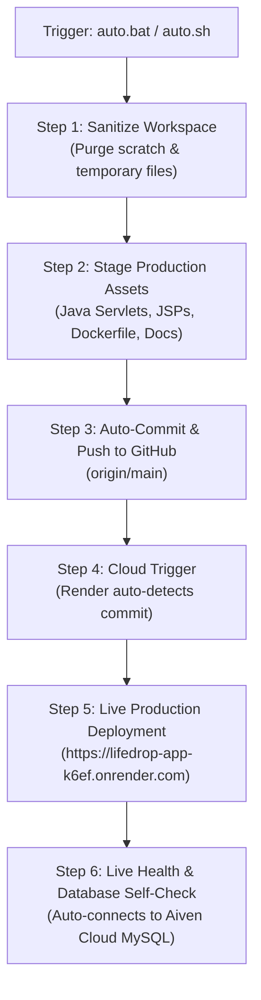

# 🤖 LifeDrop Autonomous Operations & Unified Automation

LifeDrop is configured with single-action autonomous pipelines that handle building, sanitizing, testing, synchronizing to GitHub, and triggering zero-downtime cloud redeployments.

---

## ⚡ The Single Universal Action: `auto`

Whenever you want to save, clean, push, and deploy all changes across the entire project:

### 1. In Windows (Zero Commands — Just Click):
Simply **Double-Click**:
👉 **[`auto.bat`](auto.bat)** in File Explorer.

*OR from any CMD window:*
```cmd
auto
```

### 2. In macOS / Linux / WSL:
```bash
./auto.sh
```
*OR using Make:*
```bash
make auto
```

---

## 🔄 What The Autonomous Pipeline Executes Automatically:



---

## 🧭 Live Cloud & Local Routing Summary

| Objective | Target URL / Trigger | Default Credentials |
|:---|:---|:---|
| **Live Production Web App** | [https://lifedrop-app-k6ef.onrender.com](https://lifedrop-app-k6ef.onrender.com) | *Public access* |
| **Live Database Diagnostic** | [https://lifedrop-app-k6ef.onrender.com/db-check.jsp](https://lifedrop-app-k6ef.onrender.com/db-check.jsp) | Real-time query against Aiven cluster |
| **Admin Dashboard** | [https://lifedrop-app-k6ef.onrender.com/adminLogin](https://lifedrop-app-k6ef.onrender.com/adminLogin) | **User:** `admin` \| **Pass:** `Admin@123` |
| **Donor Self-Service** | [https://lifedrop-app-k6ef.onrender.com/donorLogin](https://lifedrop-app-k6ef.onrender.com/donorLogin) | **Identifier:** `rohan.mehta@example.com` |
| **Local Full-Stack Docker** | Double-click `run.bat` | Auto-launches MySQL 8 + Embedded Tomcat |

