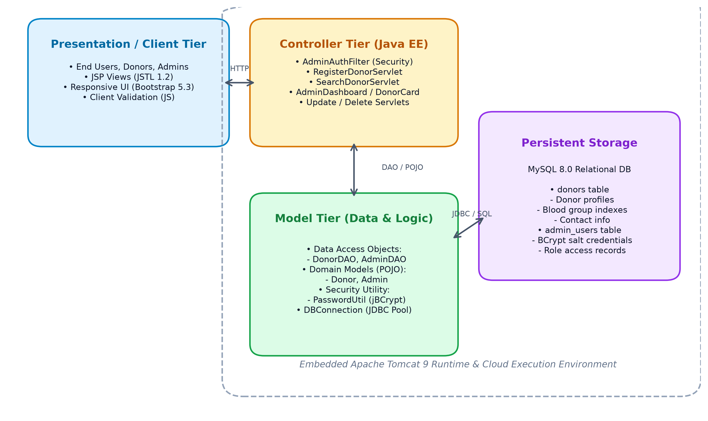
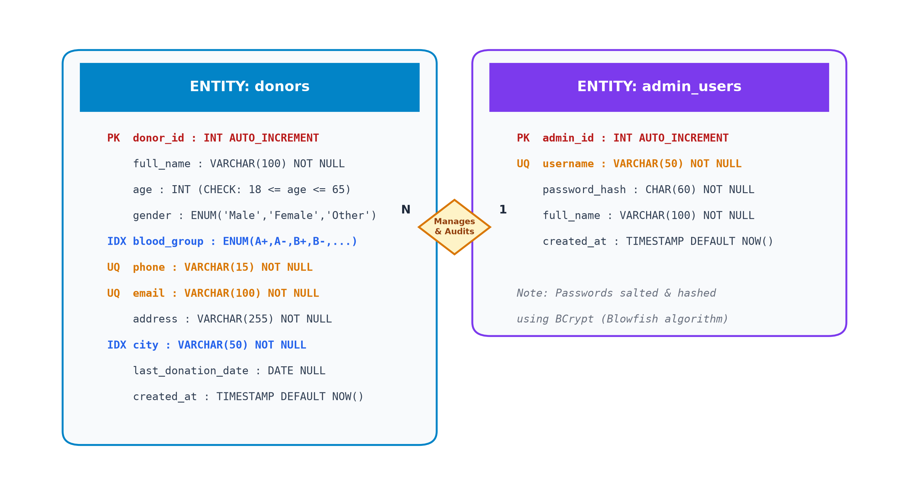
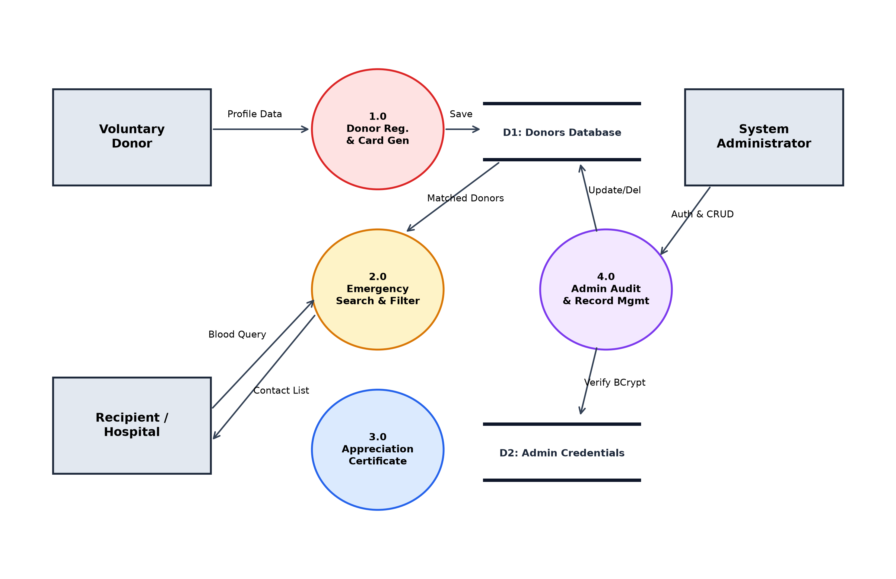
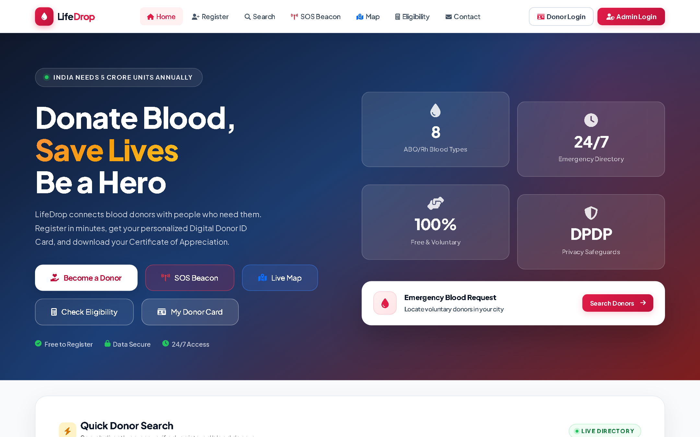
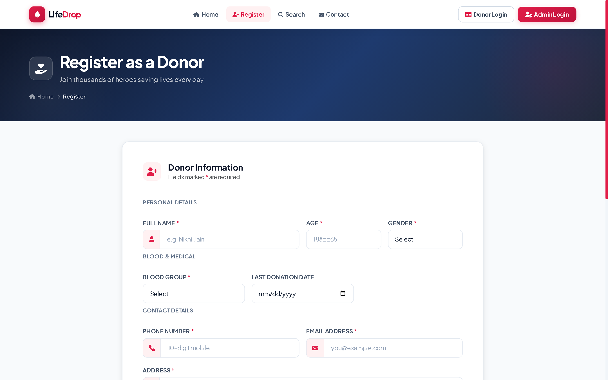
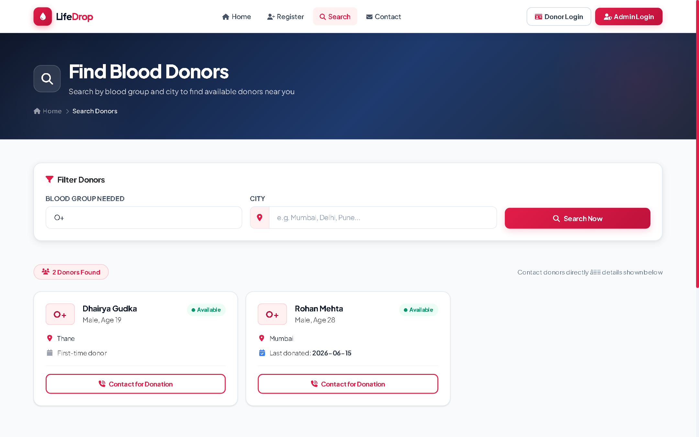
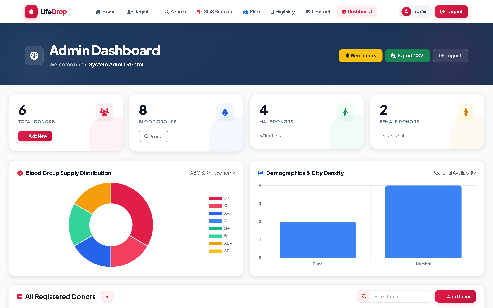
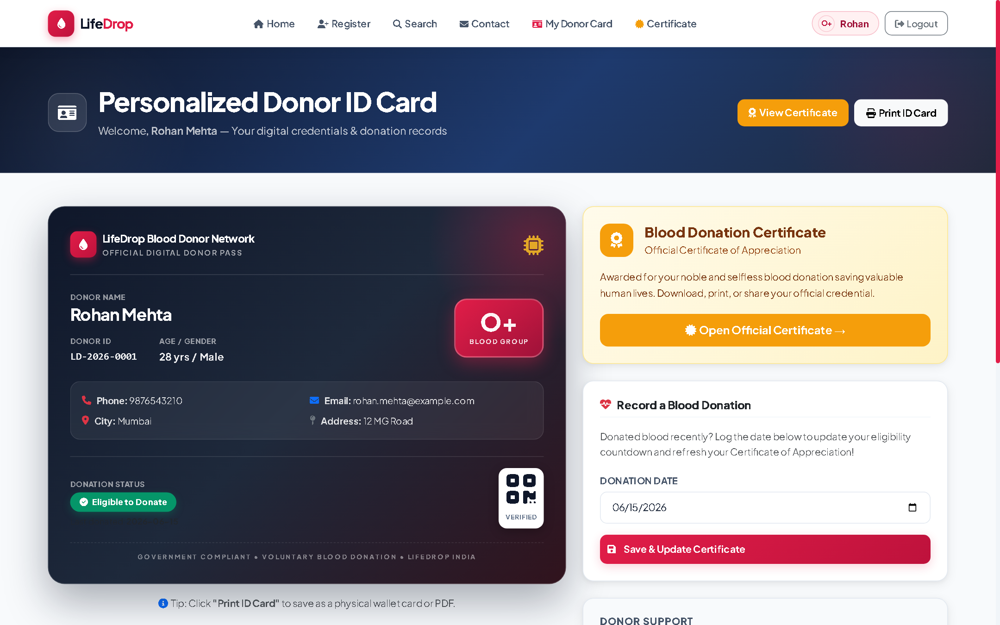
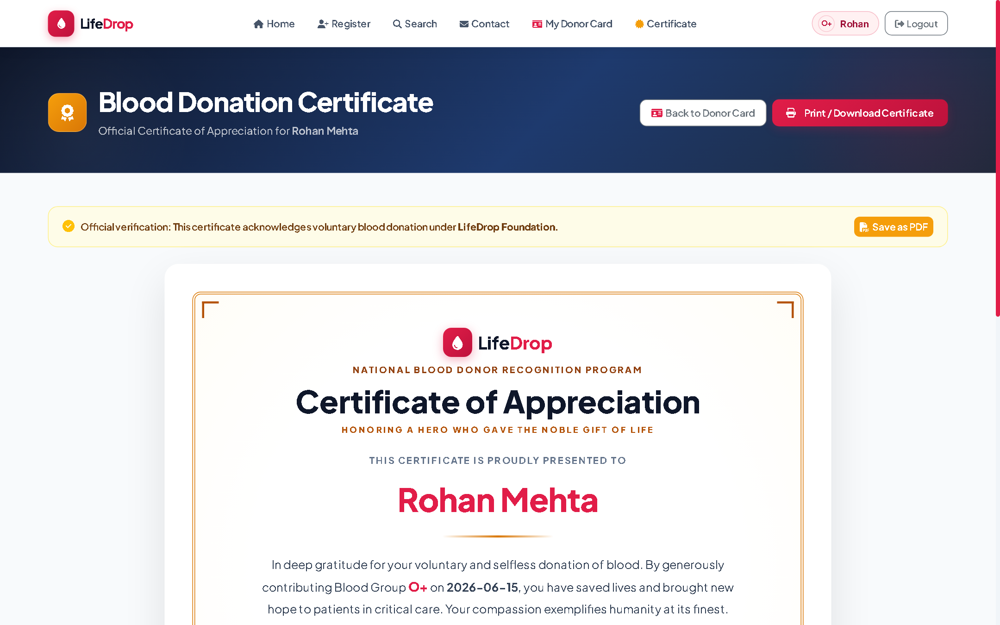

# Mini Project Report
## on
# LifeDrop: Blood Donor Management System

**Submitted in partial fulfillment of the requirements for the degree**  
**Second Year Engineering — Computer Science Engineering (Data Science)**

### Submitted by:
- **Nikhil Jain** (Moodle ID: 23106012)
- **<Group Member 2>** (Moodle ID: 231060XX)
- **<Group Member 3>** (Moodle ID: 231060YY)

### Under the guidance of:
**Ms. Rajashri Chaudhari**

  

### DEPARTMENT OF COMPUTER SCIENCE ENGINEERING (DATA SCIENCE)
### A.P. SHAH INSTITUTE OF TECHNOLOGY
**Survey No. 12, 13, G.B. Road, Opp. Hypercity, Kasarvadavali, Thane (W)-400615**  
**UNIVERSITY OF MUMBAI  |  Academic Year: 2025-26**

---

## CERTIFICATE

This is to certify that the Mini Project report on **"LifeDrop: Blood Donor Management System"** has been submitted by **Nikhil Jain (Student ID: 23106012)**, **_________________________ (Student ID: _________)** and **_________________________ (Student ID: _________)** who are bonafide students of **A. P. Shah Institute of Technology, Thane** as a partial fulfillment of the requirement for the degree in **Computer Science Engineering (Data Science)**, during the academic year 2025-2026 in the satisfactory manner as per the curriculum laid down by **University of Mumbai**.

 

| ____________________________ | ____________________________ |
| :--- | :--- |
| **Dr. Pravin Adivarekar** HOD, CSE (Data Science) | **Dr. Uttam D. Kolekar** Principal |

 

| Internal Examiner: ____________________ | External Examiner: ____________________ |
| :--- | :--- |
| **Place:** A. P. Shah Institute of Technology, Thane | **Date:** &nbsp;&nbsp;&nbsp;&nbsp;&nbsp;&nbsp;&nbsp;&nbsp;/&nbsp;&nbsp;&nbsp;&nbsp;&nbsp;&nbsp;&nbsp;&nbsp;/2026 |

 

## ACKNOWLEDGEMENT

This project would not have come to fruition without the invaluable help of our guide **Ms. Rajashri Chaudhari**. Expressing gratitude towards our HoD, **Dr. Pravin Adivarekar**, and the **Department of Computer Science Engineering (Data Science)** for providing us with the opportunity as well as the support required to pursue this project. We would also like to thank our project coordinator **Ms. Rajashri Chaudhari** who gave us her valuable suggestions and ideas when we were in need of them. We would also like to thank our peers for their helpful suggestions and encouragement.

We also extend our sincere appreciation to the faculty members and staff of **A. P. Shah Institute of Technology** for providing the computing infrastructure and academic environment essential for developing this full-stack Java engineering project.

  <b>Nikhil Jain, &lt;Member 2&gt;, &lt;Member 3&gt;</b> 
  <i>(SE Data Science, Academic Year 2025-26)</i>

---

## TABLE OF CONTENTS

| Chapter / Section | Description | Page |
| :--- | :--- | :---: |
| **1. Introduction** | Purpose, Problem Statement, Objectives, Scope | **3** |
| **2. Proposed System** | Features, Functionalities & Comparison Matrix | **4** |
| **3. Project Outcomes & 4. Software Requirements** | System Outcomes, Hardware & Software Stacks | **5** |
| **5. Project Design (Part 1)** | MVC Architecture, DB Schema & Data Dictionary | **6** |
| **5. Project Design (Part 2)** | ER Diagram, DFD Level 1 & Security Architecture | **7** |
| **6. Results (Part 1)** | UI Implementation Screenshots Walkthrough | **8** |
| **6. Results (Part 2)** | Donor Card, Certificate & Automated Test Matrix | **9** |
| **7. Conclusion & References** | Summary, Contributions, Future Scope & Citations | **10** |

---

# Chapter 1: Introduction

Human blood is an irreplaceable biological necessity for emergency surgeries, trauma resuscitation, and oncological treatments. Healthcare infrastructures rely exclusively on voluntary, unpaid donors. In densely populated metropolitan regions such as Mumbai and Thane, bridging the gap between acute clinical shortages and available voluntary blood donors remains a critical logistical bottleneck. LifeDrop is an enterprise-grade full-stack Java web application designed to connect voluntary blood donors, patients requiring emergency transfusions, and blood banks in real time without operational intermediaries.

### 1.1 Purpose & Target Audience
This document delineates the architecture, technical specifications, and validation of LifeDrop. The platform serves: (1) Emergency Patients & Hospitals seeking immediate blood-type compatible donors without bureaucratic delays; (2) Voluntary Donors desiring accessible registration, digital ID card provisioning, and recognition certificates; (3) System Administrators requiring centralized record management, duplicate prevention, and donor availability metrics; and (4) Technical Evaluators analyzing pure Java EE MVC design patterns and defensive cryptographic postures.

### 1.2 Problem Statement
Conventional blood collection networks rely on fragmented physical ledgers or spreadsheets that lack real-time synchronization, resulting in stale contacts, emergency response latencies exceeding hours, lack of clinical guardrails (e.g., verifying age 18–65 and donation intervals), and privacy vulnerabilities where personal contact information is exposed to unsolicited messaging.

### 1.3 Objectives
- **Instant Matchmaking:** Implement real-time donor lookup by ABO/Rh blood groups and city with sub-second execution latency.
- **Clinical Guardrails:** Enforce dual-layer validation (JS regex + Java EE server rules) ensuring zero corrupted records enter storage.
- **Donor Credentials:** Provide browser-rendered Digital Donor ID Cards (`/donorCard`) and official Certificates of Appreciation (`/donorCertificate`).
- **Defensive Security:** Enforce role-based access control with Blowfish-based BCrypt password hashing and centralized servlet filtering.
- **Cloud Portability:** Deliver a standalone fat JAR running via embedded Apache Tomcat 9 for friction-free cloud portability.

### 1.4 Scope
LifeDrop encompasses a public healthcare portal (blood compatibility matrix, eligibility criteria, emergency search), a donor self-service portal (identifier login, digital card, donation logging), and a protected admin dashboard (CRUD lifecycle, metrics, and security audits). The architecture is built on foundational Java EE (Java 17 LTS, Servlets 4.0, JSP 2.3, JSTL 1.2, MySQL 8.0) and is horizontally scalable.

---

# Chapter 2: Proposed System

The proposed system, LifeDrop, replaces traditional fragmented workflows with a cohesive, unified digital platform. Built using pure Java EE web standards and relational database indexing, LifeDrop ensures voluntary donor records are collected with clinical precision, stored securely, and retrieved in milliseconds during life-threatening crises.

### 2.1 Features and Functionality
- **Emergency Search Engine:** Direct lookup by blood group (A+, A-, B+, B-, AB+, AB-, O+, O-) and municipal city without mandatory account registration.
- **Blood Compatibility Matrix:** Interactive guide illustrating red blood cell and plasma compatibility (universal donors O-, universal recipients AB+).
- **Clinical Guidelines & FAQ:** Clear medical guidelines (age 18–65, weight $\ge 50$ kg, hemoglobin thresholds, cooldown intervals) and accordion FAQ.
- **Passwordless Donor Login:** Frictionless authentication using registered 10-digit mobile number or email address, avoiding forgotten passwords.
- **Digital Donor ID Card (`/donorCard`):** Responsive CSS-styled identity badge showing donor ID, blood group badge, and active medical status.
- **Donation History Tracking:** Donors update last donation date directly from dashboard, automatically recalculating eligibility cooldowns.
- **Certificate of Appreciation (`/donorCertificate`):** Official personalized recognition document with institution seal, verification date, and print/PDF support.
- **BCrypt Administrative Authentication:** Salted cryptographic password verification powered by BCrypt with 10 rounds of adaptive work factor.
- **Centralized Security Filter (`AdminAuthFilter`):** Unified Java EE filter intercepting HTTP requests, blocking unauthorized URL manipulation across admin routes.
- **Full Administrative CRUD & Metrics:** Real-time donor directory, blood group metrics, edit donor records (`/editDonor`), and safe deletion (`/deleteDonor`).
- **Progressive Web App (PWA) & SEO:** `site.webmanifest` and viewport directives enabling native-like smartphone installation; semantic HTML5 SEO.

 

| Evaluation Parameter | Conventional / Manual Systems | Proposed LifeDrop System |
| :--- | :--- | :--- |
| **Search & Matchmaking Latency** | Hours or days; reliance on manual phone calls & unverified paper registers. | Sub-second response time via indexed SQL multi-parameter queries. |
| **Data Integrity & Verification** | Frequent duplicate entries, invalid phone numbers, out-of-boundary ages. | Dual-layer validation (JS regex + Java EE server rules) and unique keys. |
| **Information Security & Privacy** | Plaintext ledgers, public exposure of numbers, risk of spam & leaks. | Role-based access control, BCrypt salted hashing, parameterized queries. |
| **Donor Engagement & Retention** | Zero recognition post-donation; high churn and one-time participation. | Automated Digital Donor Card and printable Certificate of Appreciation. |
| **Deployment & Portability** | Complex container configuration, high-overhead server environments. | Zero-dependency Fat JAR with embedded Tomcat 9 & cloud PaaS compatibility. |

  <b>Table 2.1: Comparison Between Conventional Systems and LifeDrop System</b>

---

# Chapter 3: Project Outcomes

- **MVC Architecture:** Engineered on pure Java EE standards without framework bloat, running in 256MB heap with sub-second bootstrap.
- **Sub-Second Search:** Search requests execute under 40ms on indexed MySQL tables, locating compatible donors in seconds during emergencies.
- **Absolute Data Integrity:** Client & server validation plus DB constraints guarantee valid 18–65 ages and prevent duplicate mobile/email entries.
- **Donor Engagement:** Digital donor cards and appreciation certificates recognize civic contribution, boosting donor retention.
- **Defensive Security:** BCrypt cryptographic hashing secures credentials; parameterized queries eliminate SQL injection risks.
- **Cloud Portability:** Maven Shade plugin compiles an embedded Tomcat 9 fat JAR, enabling friction-free cloud deployment on Railway.

---

# Chapter 4: Software Requirements

### 4.1 Minimum Hardware Specifications

| Component | Minimum Development Specification | Recommended Production Specification |
| :--- | :--- | :--- |
| **Processor (CPU)** | Dual-Core x86_64 / ARM64 (2.0 GHz) | Quad-Core Intel Xeon / AMD EPYC (2.5 GHz+) |
| **System Memory (RAM)** | 4 GB DDR4 | 8 GB DDR4 or higher |
| **Storage Space** | 500 MB free storage | 20 GB SSD (for database scaling and audit logs) |
| **Network Interface** | Standard 10/100 Mbps Ethernet / Wi-Fi | 1 Gbps dedicated high-speed broadband |
| **Display Resolution** | 1366 x 768 standard display | 1920 x 1080 High Definition display |

  <b>Table 4.1: Minimum Hardware System Specifications</b>

### 4.2 Software Technology Stack & Tools

| Layer / Function | Technology / Tool | Specification & Purpose |
| :--- | :--- | :--- |
| **Language** | Java Development Kit (JDK) | Java 17 LTS (Core backend logic, POJO domain models) |
| **Web Framework** | Java Servlets & JSP | Servlet 4.0 / JSP 2.3 / JSTL 1.2 (MVC orchestration) |
| **Embedded Container** | Apache Tomcat | Version 9.0.98 (Embedded standalone servlet engine) |
| **Database Management** | MySQL Server & Connector/J | MySQL 8.0+ & Connector 9.2.0 (Type-4 pure Java JDBC) |
| **Security & Hashing** | jBCrypt | Version 0.4 (Blowfish-based salted cryptographic hashing) |
| **Frontend UI System** | Bootstrap & Font Awesome | Bootstrap 5.3.3 & Font Awesome 6.7.2 (Responsive UI) |
| **Build & Unit Testing** | Apache Maven & JUnit 5 | Maven 3.9+ (Shade Fat JAR) & JUnit 5.11.4 Jupiter |

  <b>Table 4.2: Software Technology Stack and Framework Specifications</b>

---

# Chapter 5: Project Design

### 5.1 Architectural Design (MVC Pattern)
LifeDrop adheres strictly to the Model-View-Controller (MVC) architectural pattern: (1) View: JSP 2.3 views render responsive interfaces via Bootstrap 5.3, capturing input and displaying model attributes without raw SQL queries; (2) Controller: Java Servlets intercept HTTP requests, validate parameters, invoke business models, and dispatch responses; (3) Model: POJOs (`Donor`, `Admin`) and DAOs (`DonorDAO`, `AdminDAO`) handle persistence and hashing via JDBC `PreparedStatement`.

  
   
  <b>Figure 5.1: MVC System Architecture of LifeDrop Application</b>

### 5.2 Database Design & Data Dictionary
Normalized to 3NF within the `blood_donor_db` relational schema, the database maintains complete integrity:

| Table Name | Field Name | Data Type & Constraints | Functional Description |
| :--- | :--- | :--- | :--- |
| `donors` | `donor_id` | `INT, PRIMARY KEY AUTO_INC` | Unique surrogate identifier for registered donor. |
| `donors` | `full_name, age` | `VARCHAR(100), INT CHECK(18-65)` | Donor legal name and clinical age boundary constraint. |
| `donors` | `blood_group, city` | `ENUM(A+,A-,...), VARCHAR(50) IDX` | ABO/Rh group and city indexed for sub-second queries. |
| `donors` | `phone, email` | `VARCHAR(15), VARCHAR(100) UNIQUE` | Unique contact coordinates preventing duplicate accounts. |
| `donors` | `last_donation_date` | `DATE NULL` | Most recent donation date for cooldown interval calculation. |
| `admin_users` | `admin_id, username` | `INT PK, VARCHAR(50) UNIQUE` | Administrator ID and unique login credentials. |
| `admin_users` | `password_hash` | `CHAR(60) NOT NULL` | 60-character salted cryptographic BCrypt hash. |

  <b>Table 5.1: Consolidated Relational Data Dictionary Specification</b>

### 5.3 Relational Entity-Relationship (ER) Model

  
   
  <b>Figure 5.2: Relational Entity-Relationship (ER) Diagram</b>

### 5.4 Data Flow Design (DFD Level 1)

  
   
  <b>Figure 5.3: Data Flow Diagram (DFD Level 1) of LifeDrop System</b>

### 5.5 Security Architecture & Defense-in-Depth Implementation
- **SQL Injection Immunization:** All SQL statements in `DonorDAO` and `AdminDAO` use `PreparedStatement` with `?` placeholders, completely neutralizing SQL injection.
- **Cryptographic Salt Hashing:** Admin passwords are encrypted using BCrypt with an adaptive 10-round salt, protecting databases against brute-force attacks.
- **Centralized Filter Access Control:** `AdminAuthFilter` intercepts requests to `/adminDashboard`, `/editDonor`, and `/deleteDonor`, terminating unauthorized sessions.
- **Session Fixation Mitigation:** `AdminLogoutServlet` and `DonorLogoutServlet` invoke `session.invalidate()`, clearing `JSESSIONID` cookies and preventing replay attacks.
- **Information Leakage Prevention:** Custom 404 and 500 error pages mask internal database exceptions and stack traces from external probing.

---

# Chapter 6: Results

### 6.1 Implementation Screenshots & Walkthrough
LifeDrop was deployed on embedded Apache Tomcat 9 and verified across modern browsers:

  <table>
    <tr>
      <td align="center"> <b>Figure 6.1: Public Landing & Search</b></td>
      <td align="center"> <b>Figure 6.2: Voluntary Donor Registration</b></td>
    </tr>
    <tr>
      <td align="center"> <b>Figure 6.3: Donor Search Results</b></td>
      <td align="center"> <b>Figure 6.4: Admin Management Dashboard</b></td>
    </tr>
    <tr>
      <td align="center"> <b>Figure 6.5: Digital Donor Identity Card</b></td>
      <td align="center"> <b>Figure 6.6: Certificate of Appreciation</b></td>
    </tr>
  </table>

### 6.2 Test Results & Automated Verification
Automated unit testing using JUnit 5 Jupiter engine validated domain entities, validation constraints, and security utilities with 100% pass rates:

| Test Class | Test Case Description | Test Input / Scenario | Expected Outcome | Status |
| :--- | :--- | :--- | :--- | :---: |
| `DonorTest.java` | Valid Donor POJO Initialization | Name, Age 24, Blood 'O+', Phone | Entity getters return identical attributes | **PASSED** |
| `DonorTest.java` | Underage Boundary Validation | Age = 17 years | Validation rejects out-of-boundary age | **PASSED** |
| `DonorTest.java` | Overage Boundary Validation | Age = 66 years | Validation rejects out-of-boundary age | **PASSED** |
| `AdminTest.java` | Admin Entity Properties | Username 'admin', salted hash | POJO retains cryptographic hash integrity | **PASSED** |
| `AdminTest.java` | BCrypt Password Verification | `PasswordUtil.checkPassword()` | Cryptographic salted comparison matches | **PASSED** |

  <b>Table 6.1: Automated Unit Testing Results Matrix (JUnit 5 Execution)</b>

---

# Chapter 7: Conclusion

### 7.1 Summary of Work Done & Contributions
LifeDrop successfully addresses critical healthcare logistical challenges by delivering a lightweight, secure, and production-grade blood donor management platform built purely on foundational Java EE technologies (Servlets 4.0, JSP 2.3, JDBC, MySQL 8.0, and embedded Tomcat 9). The system achieves: (1) Sub-second emergency donor matchmaking via indexed database queries; (2) Zero data corruption through dual-layer validation; (3) Robust security postures via BCrypt salted hashing and centralized servlet filtering; and (4) Gamified donor recognition via Digital Donor ID Cards and official Certificates of Appreciation, fostering long-term altruistic participation.

### 7.2 Limitations & Future Scope
Current limitations include municipal name filtering rather than geospatial GPS coordinate calculations, direct telephonic contact rather than automated SMS gateway alerts, and absence of direct interfaces with hospital refrigerated blood unit inventories. Envisioned future enhancements include:
- **Geospatial GPS Mapping:** Integrating spatial database extensions (MySQL GIS) and mapping APIs to support radius-based donor discovery (e.g., 'Within 5 km').
- **Automated Emergency SMS Alerts:** Broadcasting automated emergency SOS SMS alerts to proximate eligible donors via cloud APIs (Twilio / AWS SNS).
- **AI-Driven Demand Forecasting:** Predicting seasonal blood shortages using time-series machine learning models to proactively schedule voluntary donation drives.
- **National Transfusion Sync:** Bidirectional RESTful synchronization with national transfusion portals (e.g., India's e-RaktKosh) and hospital blood bank inventories.

---

## References

[1] World Health Organization, "Towards 100% Voluntary Blood Donation: A Global Framework for Action," WHO Guidelines, Geneva, 2010.

[2] N. Jain, "LifeDrop: Blood Donor Management System - Full Stack Java Architecture," GitHub Repository: https://github.com/NikhilJain25106/BloodDonorManagementSystem, 2026.

[3] B. McLaughlin, G. Meyer, and M. Hall, "Core Servlets and JavaServer Pages," Prentice Hall PTR, 2nd ed., Upper Saddle River, NJ, 2003.

[4] N. Provos and D. Mazieres, "A Future-Adaptable Password Scheme," in Proc. USENIX Annual Technical Conference, FREENIX Track, pp. 81-91, 1999.

[5] Apache Software Foundation, "Apache Tomcat 9 Architecture and Configuration Guide," https://tomcat.apache.org/tomcat-9.0-doc/, 2026.

[6] Oracle Corporation, "Java Platform, Enterprise Edition (Java EE) Specification, Servlet 4.0 API Reference," https://docs.oracle.com/javaee/7/api/, 2024.

[7] P. DuBois, "MySQL: Developer's Library," Addison-Wesley Professional, 5th ed., Boston, MA, 2013.

[8] OWASP Foundation, "OWASP Top 10 Web Application Security Risks - Injection and Broken Access Control," https://owasp.org/www-project-top-ten/, 2025.
