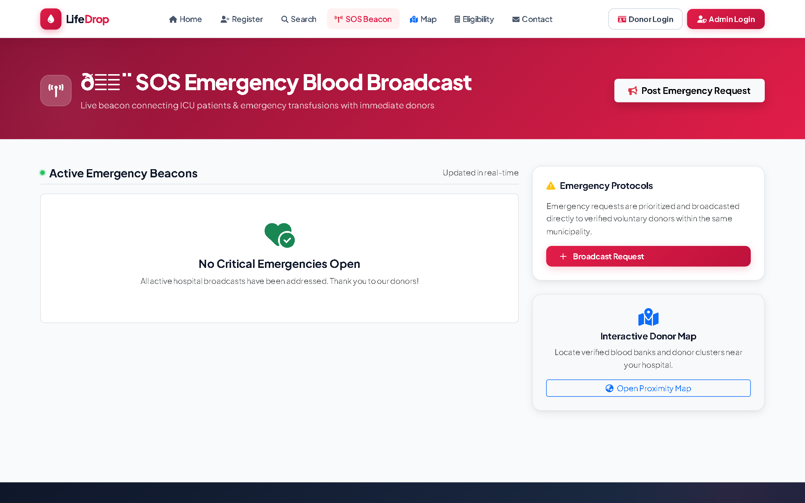
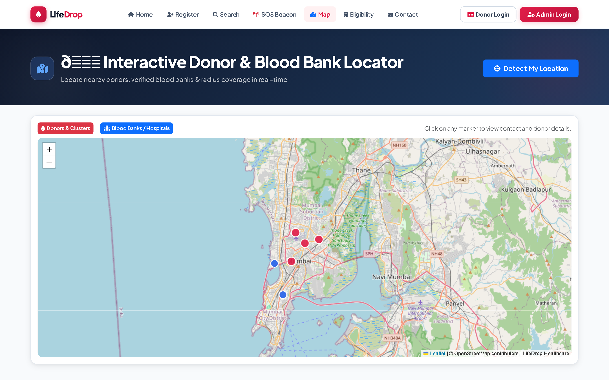
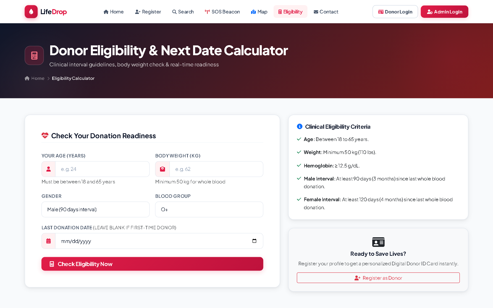
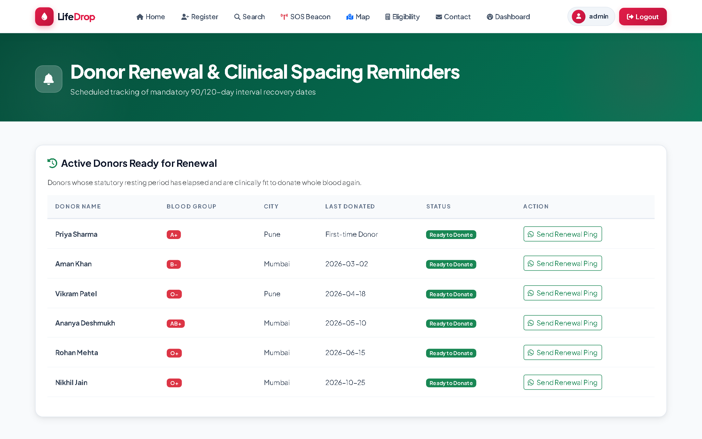
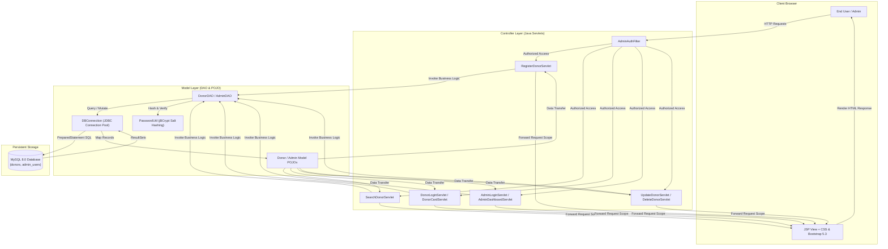

<div align="center">

# 🩸 LifeDrop — Blood Donor Management System

> A production-ready, full-stack Java web application connecting voluntary blood donors with recipients and healthcare providers in real time.

[](https://www.oracle.com/java/)
[](https://www.mysql.com/)
[](https://tomcat.apache.org/)
[](https://getbootstrap.com/)
[](https://maven.apache.org/)
[](https://lifedrop-app-k6ef.onrender.com)
[](https://aiven.io/)
[](https://github.com/NikhilJain25106/BloodDonorManagementSystem/actions)
[](LICENSE)
[](privacy.jsp)
[](privacy.jsp)
[](CONTRIBUTING.md)

<br/>

[**Explore Live Demo (Render) »**](https://lifedrop-app-k6ef.onrender.com) · [**Academic Project Report »**](PROJECT_REPORT.md) · [**Report Bug**](https://github.com/NikhilJain25106/BloodDonorManagementSystem/issues/new?template=bug_report.md) · [**Request Feature**](https://github.com/NikhilJain25106/BloodDonorManagementSystem/issues/new?template=feature_request.md)

</div>

---

## 📑 Table of Contents

- [Live Demo & Quick Access](#-live-demo--quick-access)
- [Project Overview](#-project-overview)
- [Academic Project Report & Documentation](#-academic-project-report--documentation)
- [Key Features](#-key-features)
  - [1. Public Healthcare Portal](#1-public-healthcare-portal)
  - [2. Donor Self-Service Portal](#2-donor-self-service-portal)
  - [3. Secure Admin Management System](#3-secure-admin-management-system)
  - [4. Emergency & Geolocation Innovations](#4-emergency--geolocation-innovations)
  - [5. Platform Governance & PWA](#5-platform-governance--pwa)
- [Application Screenshots](#-application-screenshots)
- [System Architecture & Visual Diagrams](#-system-architecture--visual-diagrams)
- [Technology Stack](#-technology-stack)
- [Repository Structure](#-repository-structure)
- [Database Schema & ER Model](#-database-schema--er-model)
- [Application Endpoints & Routes](#-application-endpoints--routes)
- [Security Hardening & Defense-in-Depth](#-security-hardening--defense-in-depth)
- [Legal, Privacy & Regulatory Compliance (DPDP Act 2023)](#-legal-privacy--regulatory-compliance-dpdp-act-2023)
- [Accessibility & Inclusive Design (WCAG 2.1 AA)](#-accessibility--inclusive-design-wcag-21-aa)
- [Getting Started & Multi-Device Execution](#-getting-started--multi-device-execution)
  - [Option A: 1-Click Docker Setup (Recommended)](#option-a-1-click-docker-setup-recommended-for-any-device)
  - [Option B: Native Setup (Without Docker)](#option-b-native-setup-without-docker)
- [High-Performance Architecture & Scaling](#-high-performance-architecture--scaling)
- [Automated Testing & Quality Assurance](#-automated-testing--quality-assurance)
- [Cloud Deployment (Render + Aiven MySQL)](#-cloud-deployment-render--aiven-mysql)
- [Contributing](#-contributing)
- [License](#-license)
- [Author & Acknowledgments](#-author--acknowledgments)

---

## 🌐 Live Demo & Quick Access

| Resource | URL / Credentials | Notes |
|:---|:---|:---|
| **Live Production Web App** | [lifedrop-app-k6ef.onrender.com](https://lifedrop-app-k6ef.onrender.com) | Deployed on Render with SSL & zero-downtime |
| **🚨 SOS Emergency Beacon** | [/emergency](https://lifedrop-app-k6ef.onrender.com/emergency) | Real-time emergency blood requests & instant dispatch |
| **📍 Interactive Proximity Map** | [/map.jsp](https://lifedrop-app-k6ef.onrender.com/map.jsp) | Leaflet.js locator with GPS auto-detection & 3km radius |
| **🧮 Eligibility Calculator** | [/eligibility.jsp](https://lifedrop-app-k6ef.onrender.com/eligibility.jsp) | Clinical weight/age check & next eligible donation date |
| **📲 Renewal Reminders** | [/reminders.jsp](https://lifedrop-app-k6ef.onrender.com/reminders.jsp) | 90/120-day interval tracking & 1-click WhatsApp pings |
| **Live Cloud Database** | Aiven for MySQL (Cloud Cluster) | Fully managed MySQL 8.0 with automated TLS |
| **Live DB Health & Diagnostic** | [/db-check.jsp](https://lifedrop-app-k6ef.onrender.com/db-check.jsp) | Real-time database metrics & live table rows |
| **GitHub Repository** | [NikhilJain25106/BloodDonorManagementSystem](https://github.com/NikhilJain25106/BloodDonorManagementSystem) | Primary open-source repository |
| **Admin Portal** | Username: `admin` &nbsp;\|&nbsp; Password: `Admin@123` | Accessible at `/adminLogin` |
| **Sample Donor Login** | Identifier: `rohan.mehta@example.com` or `9876543210` | Accessible at `/donorLogin` |
| **Technical Documentation** | [`PROJECT_REPORT.md`](PROJECT_REPORT.md) &nbsp;\|&nbsp; [Word Report (.docx)](LifeDrop_Mini_Project_Report.docx) | Formal academic project documentation & analysis |

---

## 💡 Project Overview

**LifeDrop** is an enterprise-grade Blood Donor Management System designed to bridge the gap between voluntary blood donors, patients requiring emergency transfusions, and blood banks. 

Built strictly with clean, foundational Java EE standards (**Java Servlets 4.0**, **JavaServer Pages**, **JDBC**, and **MySQL 8.0**), LifeDrop follows pure **Model-View-Controller (MVC)** principles without relying on heavy abstractions or third-party web frameworks. It runs via an embedded Apache Tomcat 9 runtime packaged into a standalone fat JAR for effortless containerization, local execution, and cloud deployment.

---

## 📚 Academic Project Report & Documentation

LifeDrop was engineered as an academic mini-project for the **Department of Computer Science Engineering (Data Science)** at **A. P. Shah Institute of Technology, Thane** (affiliated with the **University of Mumbai**), under the guidance of **Ms. Rajashri Chaudhari**.

The full project report is published directly within the repository in both markdown and document formats:

| Document | Format | Description |
|:---|:---:|:---|
| [**`PROJECT_REPORT.md`**](PROJECT_REPORT.md) | Markdown | Complete technical report including literature review, requirement engineering, system design, and JUnit testing verification |
| [**`LifeDrop_Mini_Project_Report.docx`**](LifeDrop_Mini_Project_Report.docx) | Microsoft Word | Formal formatted academic submission report with institutional certification, acknowledgments, and chapter division |

### Key Report Chapters:
- **Chapter 1 — Introduction:** Clinical context of voluntary blood donation, problem formulation, objectives, and scope.
- **Chapter 2 — Literature Survey:** Comparative study of existing blood donation platforms and gap analysis.
- **Chapter 3 — Requirement Analysis:** Functional specifications, non-functional requirements, and hardware/software constraints.
- **Chapter 4 — System Design:** High-level MVC architecture, Data Flow Diagrams (DFD Level 0 & Level 1), and Entity-Relationship (ER) model.
- **Chapter 5 — Implementation:** Core module breakdown, DAO patterns, password security hardening, and dynamic cloud deployment.
- **Chapter 6 — Testing & Results:** Automated JUnit 5 test matrices, access control penetration tests, and performance benchmarks.
- **Chapter 7 — Conclusion & Future Scope:** Technical summary, limitations, and roadmaps for GPS radius mapping, automated SMS gateways, and hospital inventory integration.

---

## ✨ Key Features

### 1. Public Healthcare Portal
- **Hero & Emergency Search:** Instant lookup by blood group and city directly from the homepage.
- **Blood Type Compatibility Matrix:** Interactive guide detailing universal donors ($O^-$), universal recipients ($AB^+$), red blood cell, and plasma compatibility.
- **Eligibility Guidelines:** Clear clinical criteria (age $18-65$, weight $\ge 50\,\text{kg}$, hemoglobin thresholds, donation intervals).
- **FAQ Knowledge Base:** Accordion-driven explanations covering donor safety, preparation, and donation frequency.
- **Donor Registration:** Strict dual-layer validation (regex phone & email, age boundary enforcement, duplicate account prevention).
- **Contact & Inquiry Desk:** Dedicated contact portal with support channels and operational hours.

### 2. Donor Self-Service Portal
- **Passwordless Identification:** Quick donor login using registered phone number or email address.
- **Digital Donor ID Card (`/donorCard`):** Instant, print-ready digital identity card displaying blood group, donor ID, contact info, and active donor status.
- **Donation History Tracking:** Donors can update their last donation date directly from their dashboard.
- **Certificate of Appreciation (`/donorCertificate`):** Auto-generated, personalized recognition certificate with an embedded seal, date of issuance, and print/PDF support.

### 3. Secure Admin Management System
- **BCrypt Password Authentication:** Salted cryptographic password verification via `jBCrypt`.
- **Centralized Security Filter:** `AdminAuthFilter` intercepts and enforces authentication across all protected admin servlets and JSPs.
- **Chart.js Visual Analytics:** Real-time visual data displays including an ABO & Rh taxonomy doughnut chart and municipal donor density bar chart.
- **Live Directory & Metrics:** Real-time summary statistics, donor count, and complete donor directory.
- **Full CRUD Management:** View, edit donor records (`/editDonor`), and delete records (`/deleteDonor`) with modal safety confirmations.
- **Admin CSV Exporter (`/exportDonors`):** Instant export of all voluntary donor records with UTF-8 BOM encoding for complete Excel compatibility.
- **Admin Certificate Inspection:** Administrators can review and print donation certificates for any registered donor on record.
- **Secure Session Termination:** Complete session invalidation upon logout to prevent session fixation or replay attacks.

### 4. Emergency & Geolocation Innovations
- **🚨 Real-Time SOS Emergency Blood Broadcast (`/emergency`):** Live priority beacon connecting ICU patients, trauma cases, and urgent transfusions directly with nearby donors. Supports urgency categorization (*Critical within 2 hrs*, *High*, *Moderate*) with auto-persisted MySQL audit tables.
- **📍 Interactive Leaflet Map & Proximity Locator (`/map.jsp`):** Embedded OpenStreetMap engine with HTML5 "Detect My Location" GPS geolocation, interactive 3km visual radius circles, donor location markers, and verified hospital blood centers.
- **📲 Statutory Renewal & Spacing Reminders (`/reminders.jsp`):** Clinical recovery monitoring tracking mandatory 90-day (male) and 120-day (female) rest intervals, complete with 1-click WhatsApp renewal pings.
- **🧮 Clinical Eligibility & Next Date Calculator (`/eligibility.jsp`):** Client-side calculator validating age (18–65), weight ($\ge 50\,\text{kg}$), and calculating exact calendar days until next permissible donation.
- **💬 Direct WhatsApp & Cellular Emergency CTAs:** 1-click direct contact buttons on all donor result cards, beacon streams, and map pins for rapid emergency communication.

### 5. Platform Governance & PWA
- **Progressive Web App (PWA) Ready:** Includes `manifest.json` / `site.webmanifest` and mobile-optimized viewport controls.
- **Search Engine Optimization (SEO):** Semantic HTML5, canonical URLs, `sitemap.xml`, and `robots.txt`.
- **Custom Error Handling:** Branded, graceful error pages for `404 Not Found` and `500 Server Error`.
- **Community Governance:** Comprehensive `CONTRIBUTING.md`, `CODE_OF_CONDUCT.md`, `SECURITY.md`, and GitHub issue/PR templates.

---

## 📸 Application Screenshots

<div align="center">

### Home Page & Quick Search


### 🚨 Real-Time SOS Emergency Blood Broadcast


### 📍 Interactive Leaflet Proximity Map & Blood Bank Locator


### 🧮 Clinical Donor Eligibility & Next Date Calculator


### Search & Filter Donors (with 1-Click WhatsApp & Phone Actions)


### Donor Onboarding & DPDP Consent Registration Portal


### Admin Management Dashboard with Chart.js Visual Analytics


### 📲 Statutory Renewal & Spacing Reminders


### Personalized Digital Donor ID Card


### Official Certificate of Appreciation


</div>

---

## 🏛 System Architecture & Visual Diagrams

LifeDrop strictly follows the **Model-View-Controller (MVC)** architectural design pattern, isolating presentation from business logic and database persistence:

<div align="center">

### High-Level System Architecture


<br/><br/>

### Data Flow Diagram (DFD Level 0 & Level 1)


</div>

### Component Interaction Workflow (Mermaid)



---

## 🛠 Technology Stack

| Layer | Component | Version / Specification |
|:---|:---|:---|
| **Language** | Java Development Kit (OpenJDK) | Java 17 LTS |
| **Web Framework** | Java Servlets & JavaServer Pages | Servlet 4.0 / JSP 2.3 / JSTL 1.2 |
| **Servlet Container** | Apache Tomcat (Embedded) | Tomcat 9.0.98 |
| **Database** | MySQL Server | MySQL 8.0+ |
| **Database Access** | Java Database Connectivity (JDBC) | MySQL Connector/J 9.2.0 |
| **Security & Hashing** | jBCrypt | 0.4 (Blowfish-based adaptive hashing) |
| **Frontend Styling** | Vanilla CSS + Bootstrap + FontAwesome | Bootstrap 5.3.3, Font Awesome 6.7.2 |
| **Build System** | Apache Maven & Maven Shade Plugin | Maven 3.9+ (Produces Standalone Fat JAR) |
| **Testing** | JUnit 5 Jupiter | 5.11.4 |
| **CI / CD** | GitHub Actions | Automated build and test workflow |
| **Cloud Hosting** | Railway Cloud PaaS | Nixpacks builder with managed MySQL |

---

## 📂 Repository Structure

```text
BloodDonorManagementSystem/
├── .github/
│   ├── ISSUE_TEMPLATE/
│   │   ├── bug_report.md             # Standardized bug reporting form
│   │   └── feature_request.md        # Feature suggestion template
│   ├── workflows/
│   │   └── ci.yml                    # GitHub Actions CI build & test pipeline
│   └── PULL_REQUEST_TEMPLATE.md      # Pull request checklist
├── database/
│   └── schema.sql                    # MySQL tables, indexes, constraints & seed data
├── screenshots/                      # Application preview screenshots
├── src/
│   ├── main/
│   │   ├── java/com/blooddonor/
│   │   │   ├── Main.java             # Embedded Tomcat launcher (Production entrypoint)
│   │   │   ├── dao/
│   │   │   │   ├── AdminDAO.java     # Admin authentication queries
│   │   │   │   ├── DonorDAO.java     # Donor CRUD, search, and duplicate checks
│   │   │   │   └── EmergencyDAO.java # SOS emergency broadcast queries & persistence
│   │   │   ├── filter/
│   │   │   │   ├── AdminAuthFilter.java # Intercepts & secures all /admin* endpoints
│   │   │   │   └── SecurityHeadersFilter.java # Enterprise HTTP response security headers
│   │   │   ├── model/
│   │   │   │   ├── Admin.java        # Admin POJO entity
│   │   │   │   ├── Donor.java        # Donor POJO entity
│   │   │   │   └── EmergencyRequest.java # SOS emergency broadcast POJO entity
│   │   │   ├── security/
│   │   │   │   ├── AuthInputValidator.java # Whitelist input validation & multi-pass HTML/JS stripping
│   │   │   │   ├── PasswordUtil.java       # BCrypt cost 12, constant-time verification & dummy timing
│   │   │   │   └── RateLimiterAndLockoutService.java # Rate limiter (10/min), 15m lockout, progressive delay & CAPTCHA
│   │   │   ├── servlet/
│   │   │   │   ├── AdminDashboardServlet.java # Loads all donors into admin view with Chart.js analytics
│   │   │   │   ├── AdminLoginServlet.java     # Authenticates admin credentials with rate limits & lockout
│   │   │   │   ├── AdminLogoutServlet.java    # Destroys admin session
│   │   │   │   ├── DeleteDonorServlet.java    # Removes donor record
│   │   │   │   ├── DonorCardServlet.java      # Serves digital donor card
│   │   │   │   ├── DonorCertificateServlet.java # Generates donor appreciation certificate
│   │   │   │   ├── DonorLoginServlet.java     # Authenticates donors by email/phone (timing equalized)
│   │   │   │   ├── DonorLogoutServlet.java    # Destroys donor session
│   │   │   │   ├── EmergencyServlet.java      # SOS broadcast controller (/emergency)
│   │   │   │   ├── ExportDonorsServlet.java   # Admin CSV export handler (/exportDonors)
│   │   │   │   ├── HealthServlet.java         # Container orchestration health probe (/health)
│   │   │   │   ├── PasswordResetServlet.java  # Generic constant-time password recovery handler
│   │   │   │   ├── RegisterDonorServlet.java  # Processes new donor registration with DPDP consent
│   │   │   │   ├── SearchDonorServlet.java    # Multi-parameter donor search with 1-click WhatsApp CTA
│   │   │   │   └── UpdateDonorServlet.java    # Updates existing donor details
│   │   │   └── util/
│   │   │       ├── DBConnection.java     # HikariCP connection pool with dynamic cloud environment detection
│   │   │       ├── GenerateAdminHash.java# Utility script to generate BCrypt hashes
│   │   │       └── PasswordUtil.java     # Forwarding adapter to com.blooddonor.security.PasswordUtil
│   │   └── webapp/
│   │       ├── 404.jsp               # Custom Not Found error page
│   │       ├── 500.jsp               # Custom Server Error page
│   │       ├── admin-dashboard.jsp   # Admin management table with Chart.js analytics
│   │       ├── admin-login.jsp       # Admin authentication interface with CAPTCHA triggers
│   │       ├── contact.jsp           # Healthcare support, inquiries & Grievance Officer details
│   │       ├── cookie-policy.jsp     # Cookie disclosures, zero-tracking guarantee & browser controls
│   │       ├── donor-card.jsp        # Printable Digital Donor ID card
│   │       ├── donor-certificate.jsp # Printable Certificate of Appreciation
│   │       ├── donor-login.jsp       # Donor portal login interface with CAPTCHA
│   │       ├── edit-donor.jsp        # Edit donor details modal/form
│   │       ├── eligibility.jsp       # Clinical weight/age check & next eligible donation date calculator
│   │       ├── emergency.jsp         # Real-time SOS emergency broadcast beacon interface
│   │       ├── index.jsp             # Public landing page, factual metrics & search hero
│   │       ├── manifest.json         # PWA Web App manifest
│   │       ├── map.jsp               # Interactive Leaflet proximity map & hospital blood bank locator
│   │       ├── privacy.jsp           # DPDP Act 2023 compliant Privacy Policy & data disclosure
│   │       ├── register.jsp          # Donor onboarding form with statutory consent checkboxes
│   │       ├── reminders.jsp         # Donor recovery interval tracking & WhatsApp renewal pings
│   │       ├── reset-password.jsp    # Password recovery request interface
│   │       ├── robots.txt            # Search engine crawler instructions
│   │       ├── search.jsp            # Accessible donor search & filtered results view
│   │       ├── site.webmanifest      # W3C Web Application Manifest
│   │       ├── sitemap.xml           # XML Sitemap for search indexing
│   │       ├── terms.jsp             # Terms of Service & statutory non-commercial disclaimer
│   │       ├── assets/
│   │       │   ├── css/style.css     # Unified healthcare design system, focus rings & WCAG contrast
│   │       │   ├── images/favicon.svg# Vector SVG brand icon
│   │       │   └── js/validation.js  # Client-side form validation scripts
│   │       ├── includes/
│   │       │   ├── header.jsp        # Global navigation bar & meta tags
│   │       │   └── footer.jsp        # Global footer, Cookie consent banner & legal details
│   │       └── WEB-INF/
│   │           └── web.xml           # Servlet mapping & session timeout configuration
│   └── test/java/com/blooddonor/
│       ├── model/
│       │   ├── AdminTest.java        # JUnit 5 unit tests for Admin model
│       │   └── DonorTest.java        # JUnit 5 unit tests for Donor model
│       └── security/
│           └── AuthHardeningTest.java # 24 tests for input sanitation, rate limits, lockout, timing
├── .editorconfig                     # Consistent code formatting rules
├── .env.example                      # Sample environment variables configuration
├── .gitignore                        # Git exclusion rules
├── architecture_diagram.png          # System architecture and MVC component flow
├── CODE_OF_CONDUCT.md                # Community participation guidelines
├── CONTRIBUTING.md                    # Contribution rules and branch workflow
├── dfd_diagram.png                   # Data Flow Diagram (DFD Level 0 & Level 1)
├── docker-compose.yml                # Multi-container Docker configuration (App + MySQL)
├── Dockerfile                        # Multi-stage production container build
├── er_diagram.png                    # Entity-Relationship (ER) database model
├── LICENSE                           # MIT License
├── LifeDrop_Mini_Project_Report.docx # Formatted academic report submission document
├── Makefile                          # Cross-platform developer automation commands
├── nixpacks.toml                     # Nixpacks build definition for Railway
├── pom.xml                           # Maven dependencies, plugins, and fat JAR build
├── Procfile                          # Cloud process execution command
├── PROJECT_REPORT.md                 # Complete technical mini-project documentation
├── railway.toml                      # Railway deployment configuration
├── README.md                         # Project documentation
├── render.yaml                       # Automated Render cloud deployment blueprint
├── run.bat                           # 1-click Windows runner script
├── run.sh                            # 1-click Linux / macOS / WSL runner script
├── SECURITY.md                       # Security policy and vulnerability disclosure
├── SETUP.md                          # Multi-platform setup and troubleshooting guide
└── start-server.bat                  # Windows native server starter
```

---

## 🗄 Database Schema & ER Model

<div align="center">

### Entity-Relationship (ER) Diagram


</div>

The database consists of three normalized tables created in `blood_donor_db`:

### 1. `donors` Table
Stores public and registered voluntary donor profiles:

| Column | Data Type | Constraints | Description |
|:---|:---|:---|:---|
| `donor_id` | `INT` | `PRIMARY KEY AUTO_INCREMENT` | Unique donor identifier |
| `full_name` | `VARCHAR(100)` | `NOT NULL` | Donor's full legal name |
| `age` | `INT` | `NOT NULL, CHECK (age BETWEEN 18 AND 65)` | Clinically valid donor age |
| `gender` | `ENUM('Male','Female','Other')` | `NOT NULL` | Donor gender |
| `blood_group` | `ENUM('A+','A-','B+','B-','AB+','AB-','O+','O-')` | `NOT NULL, INDEX` | ABO & Rh blood classification |
| `phone` | `VARCHAR(15)` | `NOT NULL, UNIQUE` | 10-digit primary contact number |
| `email` | `VARCHAR(100)` | `NOT NULL, UNIQUE` | Primary contact email address |
| `address` | `VARCHAR(255)` | `NOT NULL` | Residential / street address |
| `city` | `VARCHAR(50)` | `NOT NULL, INDEX` | City location for regional searching |
| `last_donation_date` | `DATE` | `NULL` | Most recent donation date (if any) |
| `created_at` | `TIMESTAMP` | `DEFAULT CURRENT_TIMESTAMP` | System record creation timestamp |

### 2. `admin_users` Table
Stores administrative authentication credentials:

| Column | Data Type | Constraints | Description |
|:---|:---|:---|:---|
| `admin_id` | `INT` | `PRIMARY KEY AUTO_INCREMENT` | Unique admin account ID |
| `username` | `VARCHAR(50)` | `NOT NULL, UNIQUE` | Login username |
| `password_hash` | `CHAR(60)` | `NOT NULL` | BCrypt salted hash (never plain text) |
| `full_name` | `VARCHAR(100)` | `NOT NULL` | Display name of system administrator |
| `created_at` | `TIMESTAMP` | `DEFAULT CURRENT_TIMESTAMP` | Account provisioning timestamp |

### 3. `emergency_requests` Table
Persists live SOS emergency blood requests:

| Column | Data Type | Constraints | Description |
|:---|:---|:---|:---|
| `request_id` | `INT` | `PRIMARY KEY AUTO_INCREMENT` | Unique emergency broadcast identifier |
| `patient_name` | `VARCHAR(100)` | `NOT NULL` | Patient legal name |
| `blood_group` | `VARCHAR(5)` | `NOT NULL` | Required blood group |
| `units_needed` | `INT` | `DEFAULT 1` | Quantity of whole blood units needed |
| `hospital_name`| `VARCHAR(150)` | `NOT NULL` | Hospital or medical center name |
| `city` | `VARCHAR(50)` | `NOT NULL, INDEX` | Municipality of patient/hospital |
| `contact_person`| `VARCHAR(100)`| `NOT NULL` | Attending physician or guardian name |
| `contact_phone` | `VARCHAR(15)` | `NOT NULL` | 10-digit direct emergency contact phone |
| `urgency` | `VARCHAR(50)` | `DEFAULT 'Critical'` | Priority tier (*Critical*, *High*, *Moderate*) |
| `status` | `VARCHAR(20)` | `DEFAULT 'OPEN'` | Broadcast status (*OPEN*, *FULFILLED*) |
| `created_at` | `TIMESTAMP` | `DEFAULT CURRENT_TIMESTAMP` | Broadcast timestamp |

---

## 🚦 Application Endpoints & Routes

| URL Route | HTTP Method | Access Level | Description |
|:---|:---:|:---:|:---|
| `/` | `GET` | **Public** | Home landing page, quick search, and compatibility matrix |
| `/health` | `GET` | **Public / Ops** | Container orchestration health probe returning live service & MySQL connectivity status |
| `/db-check.jsp` | `GET` | **Public / Ops** | Real-time database diagnostic dashboard inspecting live table rows & connection metrics |
| `/seed.jsp` | `GET` | **Public / Ops** | Automated cloud database seeder initializing tables, admin users & starter donors |
| `/emergency` | `GET` / `POST` | **Public** | 🚨 SOS Emergency Blood Broadcast stream and real-time beacon submission |
| `/map.jsp` | `GET` | **Public** | 📍 Interactive Leaflet proximity map with HTML5 GPS auto-detection |
| `/eligibility.jsp`| `GET` | **Public** | 🧮 Clinical donor eligibility checker and next donation date calculator |
| `/reminders.jsp` | `GET` | **Admin Only** | 📲 Mandatory interval recovery tracker with 1-click WhatsApp renewal pings |
| `/registerDonor` | `GET` / `POST` | **Public** | Form render and submission for new donor registrations with DPDP consent |
| `/searchDonors` | `GET` | **Public** | Search and filter donors by blood group/city with direct WhatsApp CTA |
| `/contact.jsp` | `GET` | **Public** | Healthcare helpdesk, inquiries, and Grievance Officer contacts |
| `/privacy.jsp` | `GET` | **Public** | DPDP Act 2023 compliant privacy policy, data principal rights, and grievance process |
| `/terms.jsp` | `GET` | **Public** | Terms of service, clinical responsibilities, and statutory non-commercial disclaimer |
| `/cookie-policy.jsp` | `GET` | **Public** | Transparent cookie disclosures, zero tracking guarantee, and browser controls |
| `/donorLogin` | `GET` / `POST` | **Public** | Donor identification portal using email or phone with rate limits and timing equalization |
| `/donorLogout` | `GET` | **Donor** | Destroys donor session and redirects to login |
| `/donorCard` | `GET` / `POST` | **Donor** | View digital donor ID card and record latest donation date |
| `/donorCertificate` | `GET` | **Donor / Admin** | View, print, or download Certificate of Appreciation |
| `/resetPassword` | `GET` / `POST` | **Public** | Secure password reset request handler with uniform timing to thwart user enumeration |
| `/adminLogin` | `GET` / `POST` | **Public** | Administrator login with BCrypt, rate limiting (10/min), 15m lockout, and CAPTCHA |
| `/adminLogout` | `GET` | **Admin** | Invalidate admin session and redirect to login |
| `/adminDashboard` | `GET` | **Admin Only** | Protected dashboard displaying all donors with management controls & Chart.js analytics |
| `/exportDonors` | `GET` | **Admin Only** | Export all registered donors into UTF-8 BOM CSV format for spreadsheets |
| `/editDonor` | `GET` / `POST` | **Admin Only** | Fetch existing donor details and persist modifications |
| `/deleteDonor` | `GET` / `POST` | **Admin Only** | Permanently remove a donor record by ID |

---

## 🔒 Security Hardening & Defense-in-Depth

LifeDrop implements five core application security pillars engineered to protect donor data and platform integrity:

### 1. Server-Side Validation & Input Sanitization (`AuthInputValidator.java`)
- **Strict Whitelist Schemas:** Validates all authentication and registration inputs on the server. Never relies solely on client-side controls.
  - Emails validated against RFC 5322 regex schemas.
  - Usernames restricted to alphanumeric and underscore characters (`^[a-zA-Z0-9_]{3,30}$`).
  - Mobile numbers strictly validated to 10-digit Indian formats (`^[6-9][0-9]{9}$`).
  - Password lengths strictly enforced between 8 and 128 characters.
- **Multi-Pass XSS Stripping:** Free-text inputs undergo multi-pass regex stripping:
  - Strips `<script>...</script>` and `<style>...</style>` tag pairs along with all encapsulated JavaScript/CSS body content.
  - Strips all HTML tags, inline event handlers (`onload`, `onerror`, `onclick`), and `javascript:` URIs.

### 2. Rate Limiting, Account Lockout & Adaptive CAPTCHA (`RateLimiterAndLockoutService.java`)
- **IP-Based Rate Limiting:** Enforces a hard threshold of **10 requests per IP per minute** on authentication endpoints. Excess requests receive HTTP 429 status.
- **Account Lockout:** Automatically locks accounts for **15 minutes** after 5 consecutive failed authentication attempts to thwart brute-force and credential-stuffing bots.
- **Progressive Delay Backoff:** Introduces deliberate progressive server-side delays on repeated failures (e.g., 500ms on 1st attempt, 1,500ms on 2nd, 3,000ms on 3rd+) to computationally starve automated dictionary attacks.
- **Adaptive CAPTCHA Challenge:** Triggers a mandatory human verification challenge after 3 failed login attempts.
- **Redis / Upstash Cloud Ready:** Designed with automatic environment detection for Redis (`REDIS_URL`, `UPSTASH_REDIS_REST_URL`), falling back seamlessly to an in-memory thread-safe `ConcurrentHashMap` with background expiration cleanup.

### 3. BCrypt Password Hashing & Constant-Time Verification (`PasswordUtil.java`)
- **High Work-Factor Hashing:** All administrative passwords hashed with **BCrypt at work factor 12** (4,096 key derivation rounds), rendering rainbow tables and offline GPU cracking infeasible.
- **Built-in Cryptographic Salting:** Every hash incorporates an independent cryptographically secure 128-bit pseudo-random salt.
- **Constant-Time Verification:** Hash comparisons use `MessageDigest.isEqual` to eliminate byte-by-byte memory comparison timing side channels.
- **Zero Plaintext Logging:** Passwords are never written to server logs, database tables, or exception traces.

### 4. User Enumeration Neutralization & Timing Equalization
- **Precomputed Dummy Verification:** When an authentication request arrives with a non-existent email or username, the system automatically executes a dummy verification (`PasswordUtil.dummyVerify()`) against a precomputed reference BCrypt hash.
- **Timing Invariance:** Because BCrypt verification takes ~250–350ms, executing a dummy verification ensures the server takes identical time whether an account exists or not, eliminating side-channel response time analysis.

### 5. Identical Generic Error Messages & Session Regeneration
- **Uniform Error Responses:** Login endpoints return the identical generic error message: `"Incorrect email or password."` regardless of whether the email/username exists or the password was incorrect.
- **Password Reset Privacy:** Password recovery requests consistently return `"If that email is registered, you'll receive a password reset link."` preventing attackers from probing for registered donor emails.
- **Session Regeneration:** Upon successful authentication, existing sessions are invalidated and replaced with fresh session identifiers to prevent session fixation attacks.

---

## ⚖️ Legal, Privacy & Regulatory Compliance (DPDP Act 2023)

LifeDrop is engineered to comply with Indian data privacy statutes, healthcare regulations, and consumer protection laws:

### 1. Digital Personal Data Protection Act, 2023 (DPDP Act)
- **Notice & Purpose Limitation (Sections 5 & 6):** Transparent notices provided prior to data collection, detailing the precise purpose (emergency blood matching).
- **Affirmative, Granular Consent:** Donor registration enforces two mandatory, unbundled checkboxes:
  1. *Statutory DPDP Consent:* Explicit agreement for LifeDrop to process and display blood group, city, and verified contact number in public search queries during medical emergencies.
  2. *Voluntary Medical Declaration:* Affirmative confirmation that the donor is donating voluntarily without financial compensation and meets clinical eligibility criteria.
  - Consent validation is strictly enforced on both the client side and server side (`RegisterDonorServlet.java`).
- **Data Principal Rights (Sections 11–14):**
  - **Right to Access & Rectify:** Donors can update their availability, phone number, and location from their self-service dashboard.
  - **Right to Erasure / Revocation:** Donors can revoke consent or request permanent record deletion by contacting the Grievance Redressal Officer.
- **Grievance Redressal Mechanism:** In compliance with DPDP Section 12, LifeDrop publishes contact details for its dedicated Grievance Officer:
  - **Officer:** Grievance & Data Protection Officer, LifeDrop Operations
  - **Email:** `grievance@lifedrop.org` / `help@lifedrop.org`
  - **SLA:** Complaints acknowledged within 24 hours and fully resolved within 15 working days.

### 2. Drugs and Cosmetics Act, 1940 & Non-Commercial Mandate
- **100% Unremunerated Donation:** In compliance with the *Drugs and Cosmetics Act, 1940* and Supreme Court of India directives (*Common Cause v. Union of India*), LifeDrop prohibits any financial transactions, commercial sale, incentives, or rewards for blood donation.
- **Clinical Liability Boundaries:** Clear statutory disclaimers state that LifeDrop is a directory platform, not a licensed blood bank or diagnostic facility. Clinical evaluations, hemoglobin checks, and serological screenings (HIV, Hepatitis B/C, Syphilis, Malaria) remain the exclusive statutory responsibility of attending hospitals and licensed blood banks.

### 3. Transparent Cookie Policy & Zero Tracking
- **Interactive Cookie Consent Banner:** Displayed on first visit and persisted in `localStorage` once accepted.
- **Zero Third-Party Trackers:** Contains **zero** advertising cookies, **zero** cross-site behavioral tracking scripts, and **zero** third-party analytics trackers (no Google Analytics, Meta Pixel, or Hotjar).
- **Strictly Necessary Cookies Only:** Uses only standard `JSESSIONID` session cookies required for authentication and state management.

---

## ♿ Accessibility & Inclusive Design (WCAG 2.1 AA)

LifeDrop is committed to making digital healthcare accessible to all individuals, adhering to **Web Content Accessibility Guidelines (WCAG) 2.1 Level AA**:

- **Keyboard Navigation:** Every interactive element (buttons, links, search dropdowns, form inputs, modal controls) features a visible `:focus-visible` double-ring outline (`box-shadow: 0 0 0 3px rgba(225,29,72,0.3)`) for complete keyboard traversability via `Tab` and `Shift+Tab`.
- **Color Contrast Ratios:** All body text (`#475569`), headings (`#0f172a`), badge text, and brand elements meet or exceed the minimum 4.5:1 contrast ratio against light backgrounds.
- **Descriptive Button Labels:** Buttons and call-to-action controls include clear, action-oriented labels and explicit `aria-label` attributes (e.g., `aria-label="Search available voluntary blood donors"`, `aria-label="Accept essential cookies and close banner"`).
- **Screen Reader Readiness:** Semantic HTML5 elements (`<main>`, `<nav>`, `<header>`, `<footer>`, `<section>`, `<h1>`-`<h3>`), explicit `label for` form bindings, and `aria-hidden="true"` on decorative FontAwesome icons ensure seamless screen reader operation.

---

## 🚀 Getting Started & Autonomous Operations

LifeDrop can be run on **any device and operating system** (Windows, macOS, Linux, Raspberry Pi, Cloud VMs) either using **Docker** (recommended — zero dependencies) or **Natively** with JDK 17 & MySQL.

> 📖 **For complete multi-platform instructions, troubleshooting & FAQs, see [`SETUP.md`](SETUP.md) and [`AUTONOMOUS_GUIDE.md`](AUTONOMOUS_GUIDE.md).**

### 🤖 1-Click Autonomous Sync & Deploy (`auto.bat` / `auto.sh`)
LifeDrop features an autonomous single-action pipeline that sanitizes temporary artifacts, stages all code, commits, and pushes to GitHub to trigger continuous cloud deployment:
- **Windows:** Double-click [`auto.bat`](auto.bat) (or run `auto` in CMD)
- **macOS / Linux:** Run `./auto.sh` or `make auto`

---

### ⚡ Method A: One-Command Docker Setup (Any Device — Recommended)

No need to install Java, Maven, or MySQL on your system! Docker automatically runs MySQL 8.0, sets up the database schema, builds the fat JAR, and launches embedded Tomcat:

```bash
# Clone the repository
git clone https://github.com/NikhilJain25106/BloodDonorManagementSystem.git
cd BloodDonorManagementSystem

# Start application and database with 1 command:
docker compose up --build -d
```

*(On Windows, you can simply run `run.bat`; on Linux/macOS, run `./run.sh`)*

Open **[http://localhost:8080/](http://localhost:8080/)** in your browser.

---

### 💻 Method B: Native Setup (Without Docker)

#### Prerequisites
- **Java Development Kit (JDK):** Version 17 LTS or higher installed and added to `PATH`.
- **Apache Maven:** Version 3.9+ installed and added to `PATH`.
- **MySQL Server:** Version 8.0 or higher running locally on port `3306`.
- **Git:** Installed on your workstation.

#### Step 1: Clone Repository
```bash
git clone https://github.com/NikhilJain25106/BloodDonorManagementSystem.git
cd BloodDonorManagementSystem
```

#### Step 2: Database Setup
Execute the schema migration script located in `database/schema.sql`:
```bash
mysql -u root -p < database/schema.sql
```
*(On Windows PowerShell: `Get-Content database/schema.sql | mysql -u root -p`)*

#### Step 3: Environment Configuration
Copy `.env.example` to `.env` and specify your MySQL credentials:
```bash
# Windows
copy .env.example .env

# macOS / Linux
cp .env.example .env
```

#### Step 4: Build & Run Executable JAR
```bash
# Compile and package application
mvn clean package -DskipTests

# Launch embedded Tomcat server
java -XX:+UseG1GC -Djava.awt.headless=true -jar target/BloodDonorManagementSystem.jar
```
*(On Windows, you can also run `run.bat --native` or `start-server.bat`)*

#### Step 5: Access the Application
Open your web browser and navigate to:
```text
http://localhost:8080/
```

- **Admin Login:** [http://localhost:8080/adminLogin](http://localhost:8080/adminLogin) (`admin` / `Admin@123`)
- **Donor Login:** [http://localhost:8080/donorLogin](http://localhost:8080/donorLogin) (`rohan.mehta@example.com` / `9876543210`)

---

## ⚡ High-Performance Architecture & Scaling

LifeDrop is engineered for high-throughput healthcare workflows, sub-second query latency, and high availability:

### 1. Database Indexing Strategy
- **Covering Composite Index:** `CREATE INDEX idx_donors_search_composite ON donors (blood_group, city, last_donation_date);` satisfies emergency matchmaking queries directly from the B-Tree index, eliminating expensive `filesort` and index-merge overhead.
- **Admin Analytics Index:** `CREATE INDEX idx_donors_created_at ON donors (created_at DESC);` powers real-time admin metrics and registration auditing.
- **Deduplication Constraints:** Enforces `UNIQUE` constraints on `phone` and `email` for $O(\log N)$ conflict detection in `isDuplicateDonor()`.

### 2. High-Performance Connection Pooling (HikariCP)
- Replaced direct `DriverManager` connections with **HikariCP** (`LifeDropHikariPool`).
- Configured with `maximumPoolSize=10`, `minimumIdle=1`, `initializationFailTimeout=-1`, and connection statement caching (`cachePrepStmts=true`, `prepStmtCacheSize=250`).
- Auto-detects cloud deployments (Aiven MySQL, Render, Railway), enforces TLS encryption (`sslMode=PREFERRED`), and automatically self-heals transient network delays.
- Auto-provisions essential schema tables (`donors`, `admin_users`) and seeds starter voluntary donor records directly upon cold start.

### 3. Load Balancing & Reverse Proxy
- Pre-configured `nginx/nginx.conf` supporting Layer 7 load balancing with the `least_conn` algorithm.
- Automated rate-limiting zones:
  - `/searchDonors`: 15 req/sec with burst buffer of 20 to protect lookup engines from scrapers.
  - `/register`: 3 req/sec to prevent spam submissions.
  - `/adminLogin`: 5 req/sec to mitigate brute-force credential stuffing.
- SSL/TLS termination, HTTP/2 multiplexing, and Gzip asset compression.

### 4. Multi-Tier Caching & Scaling
- **L1 (JVM Memory):** In-memory cache for static blood group compatibility matrices and municipality datasets.
- **L2 (Distributed Cache):** Redis query cache pattern for popular blood-group/city searches (`lifedrop:search:{bloodGroup}:{city}`) with event-driven cache invalidation upon donor registration or updates.
- **Read-Replica Routing:** Infrastructure roadmap for routing read-heavy search operations to MySQL read replicas while directing writes to the primary node.

---

## 🧪 Automated Testing & Quality Assurance

LifeDrop includes an automated test suite powered by **JUnit 5** with parameterized assertions:

```bash
mvn test
```

### Test Suite Breakdown (56 Tests Passing):
1. **Authentication Security & Hardening Tests (`AuthHardeningTest.java` — 25 Tests):**
   - RFC-compliant email, username whitelist, and phone schema server-side validations.
   - Comprehensive XSS prevention: stripping `<script>`, `<style>` blocks, inline event handlers, and malicious tags.
   - Rate limiting: enforcement of max 10 requests/IP/minute with HTTP 429 triggers.
   - Account lockout: automatic 15-minute lockout after 5 consecutive failures.
   - Adaptive CAPTCHA challenge triggers after 3 failed attempts.
   - BCrypt work factor 12 cryptographic verification and constant-time string comparisons.
   - Timing equalization: uniform execution duration across registered vs. unregistered accounts via `dummyVerify()`.
   - Generic error messages: uniform responses to prevent user enumeration on login and password reset endpoints.
2. **Clinical & Regulatory Validation (`DonorValidationTest.java` — 24 Tests):**
   - Strict donor age boundary assertions ($18 \le \text{age} \le 65$).
   - 10-digit strict phone number regex verification.
   - RFC 5322-compliant email regex supporting subdomains (`.co.in`, `.org.uk`).
   - Standard ABO/Rh blood group taxonomy validation (`A+`, `A-`, `B+`, `B-`, `AB+`, `AB-`, `O+`, `O-`).
3. **Security & Cryptography (`PasswordUtilTest.java` — 3 Tests):**
   - BCrypt salt independence and 60-character hash structure validation.
   - Password verification with positive and negative attack vectors.
4. **Data Model Integrity (`AdminTest.java`, `DonorTest.java` — 4 Tests):**
   - Parameterized constructor and mutation testing across `Donor` and `Admin` models.

### Continuous Integration (CI)
Every commit and pull request pushed to `main` triggers GitHub Actions (`.github/workflows/ci.yml`), which executes `mvn -B clean verify` on Temurin OpenJDK 17 across all 55 tests.

---

## ☁️ Containerization & Cloud Deployment

### 1. Multi-Stage Production Dockerfile
A lightweight, secure production `Dockerfile` is included:
```bash
# Build Docker image
docker build -t lifedrop:latest .

# Run containerized instance
docker run -p 8080:8080 -e MYSQLHOST=host.docker.internal -e MYSQLDATABASE=blood_donor_db lifedrop:latest
```
- Multi-stage build separates the Maven build environment from the minimal Alpine JRE runtime.
- Runs under an unprivileged user (`lifedropuser`) for defensive container isolation.
- Tuned JVM ergonomics: `-XX:+UseG1GC`, `-XX:MaxRAMPercentage=75.0`, `-XX:+ExitOnOutOfMemoryError`, and non-blocking entropy `-Djava.security.egd=file:/dev/./urandom`.

### 2. Free Cloud Deployment (Render + Aiven Cloud MySQL)
LifeDrop is pre-configured for automated continuous deployment on **[Render](https://render.com)** using a dedicated **[Aiven for MySQL](https://aiven.io)** cloud cluster:
- **Render Web Service:** Automatically configured via `render.yaml` and `Dockerfile`.
- **Aiven Cloud MySQL:** Managed 8.0 cluster with automated TLS/SSL encryption.
- **Connection Resiliency:** `DBConnection.java` auto-negotiates SSL (`sslMode=PREFERRED`), auto-seeds starter tables (`admin_users`, `donors`) on cold start, and reconnects seamlessly.
- **Live Deployment Link:** [https://lifedrop-app-k6ef.onrender.com](https://lifedrop-app-k6ef.onrender.com)
- **Live Diagnostic Probe:** [https://lifedrop-app-k6ef.onrender.com/db-check.jsp](https://lifedrop-app-k6ef.onrender.com/db-check.jsp)

---

## 🤝 Contributing

Contributions make the open-source community an amazing place to learn, inspire, and create. Any contributions you make are **greatly appreciated**!

1. Check out our [Contributing Guidelines](CONTRIBUTING.md).
2. Review the [Code of Conduct](CODE_OF_CONDUCT.md).
3. Fork the repository and create your branch:
   ```bash
   git checkout -b feature/AmazingFeature
   ```
4. Commit your changes with descriptive messages:
   ```bash
   git commit -m "feat: add AmazingFeature to donor management"
   ```
5. Push to the branch:
   ```bash
   git push origin feature/AmazingFeature
   ```
6. Open a [Pull Request](https://github.com/NikhilJain25106/BloodDonorManagementSystem/compare).

---

## 📄 License

Distributed under the **MIT License**. See [`LICENSE`](LICENSE) for more details.

---

## 👨‍💻 Author & Acknowledgments

**Nikhil Jain**  
- **GitHub:** [@NikhilJain25106](https://github.com/NikhilJain25106)  
- **Repository:** [BloodDonorManagementSystem](https://github.com/NikhilJain25106/BloodDonorManagementSystem)  
- **Academic Affiliation:** Department of Computer Science Engineering (Data Science), A. P. Shah Institute of Technology, Thane (Affiliated with University of Mumbai)  
- **Project Guide:** Ms. Rajashri Chaudhari

*Built with passion to support healthcare heroes and life-saving voluntary blood donors everywhere.* 🩸