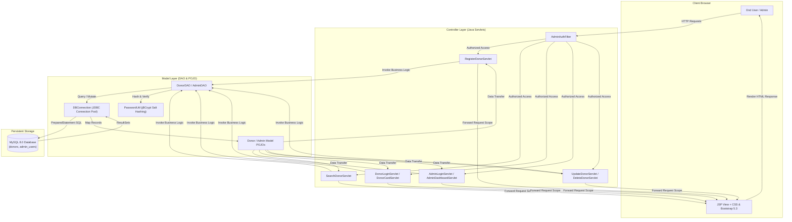

<div align="center">

# 🩸 LifeDrop — Blood Donor Management System

> A production-ready, full-stack Java web application connecting voluntary blood donors with recipients and healthcare providers in real time.

[](https://www.oracle.com/java/)
[](https://www.mysql.com/)
[](https://tomcat.apache.org/)
[](https://getbootstrap.com/)
[](https://maven.apache.org/)
[](https://railway.app/)
[](https://github.com/NikhilJain25106/BloodDonorManagementSystem/actions)
[](LICENSE)
[](CONTRIBUTING.md)

<br/>

[**Explore Live Demo »**](https://lifedrop-app.up.railway.app) · [**Report Bug**](https://github.com/NikhilJain25106/BloodDonorManagementSystem/issues/new?template=bug_report.md) · [**Request Feature**](https://github.com/NikhilJain25106/BloodDonorManagementSystem/issues/new?template=feature_request.md)

</div>

---

## 📑 Table of Contents

- [Live Demo & Quick Access](#-live-demo--quick-access)
- [Project Overview](#-project-overview)
- [Key Features](#-key-features)
  - [1. Public Healthcare Portal](#1-public-healthcare-portal)
  - [2. Donor Self-Service Portal](#2-donor-self-service-portal)
  - [3. Secure Admin Management System](#3-secure-admin-management-system)
  - [4. Platform Governance & PWA](#4-platform-governance--pwa)
- [Application Screenshots](#-application-screenshots)
- [System Architecture](#-system-architecture)
- [Technology Stack](#-technology-stack)
- [Repository Structure](#-repository-structure)
- [Database Schema](#-database-schema)
- [Application Endpoints & Routes](#-application-endpoints--routes)
- [Security Hardening](#-security-hardening)
- [Getting Started](#-getting-started)
  - [Prerequisites](#prerequisites)
  - [Step 1: Clone Repository](#step-1--clone-repository)
  - [Step 2: Database Setup](#step-2--database-setup)
  - [Step 3: Environment Configuration](#step-3--environment-configuration)
  - [Step 4: Seed Admin Credentials](#step-4--seed-admin-credentials)
  - [Step 5: Build & Run Executable JAR](#step-5--build--run-executable-jar)
  - [Step 6: Access the Application](#step-6--access-the-application)
- [Automated Testing & CI/CD](#-automated-testing--cicd)
- [Cloud Deployment (Railway)](#-cloud-deployment-railway)
- [Contributing](#-contributing)
- [License](#-license)
- [Author & Acknowledgments](#-author--acknowledgments)

---

## 🌐 Live Demo & Quick Access

| Resource | URL / Credentials | Notes |
|:---|:---|:---|
| **Live Application** | [lifedrop-app.up.railway.app](https://lifedrop-app.up.railway.app) | Hosted on Railway with cloud MySQL |
| **GitHub Repository** | [NikhilJain25106/BloodDonorManagementSystem](https://github.com/NikhilJain25106/BloodDonorManagementSystem) | Primary open-source repository |
| **Admin Portal** | Username: `admin` &nbsp;\|&nbsp; Password: `Admin@123` | Accessible at `/adminLogin` |
| **Sample Donor Login** | Identifier: `rohan.mehta@example.com` or `9876543210` | Accessible at `/donorLogin` |

---

## 💡 Project Overview

**LifeDrop** is an enterprise-grade Blood Donor Management System designed to bridge the gap between voluntary blood donors, patients requiring emergency transfusions, and blood banks. 

Built strictly with clean, foundational Java EE standards (**Java Servlets 4.0**, **JavaServer Pages**, **JDBC**, and **MySQL 8.0**), LifeDrop follows pure **Model-View-Controller (MVC)** principles without relying on heavy abstractions or third-party web frameworks. It runs via an embedded Apache Tomcat 9 runtime packaged into a standalone fat JAR for effortless containerization, local execution, and cloud deployment.

---

## ✨ Key Features

### 1. Public Healthcare Portal
- **Hero & Emergency Search:** Instant lookup by blood group and city directly from the homepage.
- **Blood Type Compatibility Matrix:** Interactive guide detailing universal donors ($O^-$), universal recipients ($AB^+$), red blood cell, and plasma compatibility.
- **Eligibility Guidelines:** Clear clinical criteria (age $18-65$, weight $\ge 50\,\text{kg}$, hemoglobin thresholds, donation intervals).
- **FAQ Knowledge Base:** Accordion-driven explanations covering donor safety, preparation, and donation frequency.
- **Donor Registration:** Strict dual-layer validation (regex phone & email, age boundary enforcement, duplicate account prevention).
- **Contact & Inquiry Desk:** Dedicated contact portal with support channels and operational hours.

### 2. Donor Self-Service Portal
- **Passwordless Identification:** Quick donor login using registered phone number or email address.
- **Digital Donor ID Card (`/donorCard`):** Instant, print-ready digital identity card displaying blood group, donor ID, contact info, and active donor status.
- **Donation History Tracking:** Donors can update their last donation date directly from their dashboard.
- **Certificate of Appreciation (`/donorCertificate`):** Auto-generated, personalized recognition certificate with an embedded seal, date of issuance, and print/PDF support.

### 3. Secure Admin Management System
- **BCrypt Password Authentication:** Salted cryptographic password verification via `jBCrypt`.
- **Centralized Security Filter:** `AdminAuthFilter` intercepts and enforces authentication across all protected admin servlets and JSPs.
- **Live Directory & Metrics:** Real-time summary statistics, donor count, and complete donor directory.
- **Full CRUD Management:** View, edit donor records (`/editDonor`), and delete records (`/deleteDonor`) with modal safety confirmations.
- **Admin Certificate Inspection:** Administrators can review and print donation certificates for any registered donor on record.
- **Secure Session Termination:** Complete session invalidation upon logout to prevent session fixation or replay attacks.

### 4. Platform Governance & PWA
- **Progressive Web App (PWA) Ready:** Includes `manifest.json` / `site.webmanifest` and mobile-optimized viewport controls.
- **Search Engine Optimization (SEO):** Semantic HTML5, canonical URLs, `sitemap.xml`, and `robots.txt`.
- **Custom Error Handling:** Branded, graceful error pages for `404 Not Found` and `500 Server Error`.
- **Community Governance:** Comprehensive `CONTRIBUTING.md`, `CODE_OF_CONDUCT.md`, `SECURITY.md`, and GitHub issue/PR templates.

---

## 📸 Application Screenshots

<div align="center">

### Home Page & Quick Search


### Donor Registration Portal


### Search & Filter Donors


### Admin Management Dashboard


### Personalized Digital Donor ID Card


### Official Certificate of Appreciation


</div>

---

## 🏛 System Architecture

The project strictly follows the **Model-View-Controller (MVC)** architectural design pattern:



---

## 🛠 Technology Stack

| Layer | Component | Version / Specification |
|:---|:---|:---|
| **Language** | Java Development Kit (OpenJDK) | Java 17 LTS |
| **Web Framework** | Java Servlets & JavaServer Pages | Servlet 4.0 / JSP 2.3 / JSTL 1.2 |
| **Servlet Container** | Apache Tomcat (Embedded) | Tomcat 9.0.98 |
| **Database** | MySQL Server | MySQL 8.0+ |
| **Database Access** | Java Database Connectivity (JDBC) | MySQL Connector/J 9.2.0 |
| **Security & Hashing** | jBCrypt | 0.4 (Blowfish-based adaptive hashing) |
| **Frontend Styling** | Vanilla CSS + Bootstrap + FontAwesome | Bootstrap 5.3.3, Font Awesome 6.7.2 |
| **Build System** | Apache Maven & Maven Shade Plugin | Maven 3.9+ (Produces Standalone Fat JAR) |
| **Testing** | JUnit 5 Jupiter | 5.11.4 |
| **CI / CD** | GitHub Actions | Automated build and test workflow |
| **Cloud Hosting** | Railway Cloud PaaS | Nixpacks builder with managed MySQL |

---

## 📂 Repository Structure

```text
BloodDonorManagementSystem/
├── .github/
│   ├── ISSUE_TEMPLATE/
│   │   ├── bug_report.md             # Standardized bug reporting form
│   │   └── feature_request.md        # Feature suggestion template
│   ├── workflows/
│   │   └── ci.yml                    # GitHub Actions CI build & test pipeline
│   └── PULL_REQUEST_TEMPLATE.md      # Pull request checklist
├── database/
│   └── schema.sql                    # MySQL tables, indexes, constraints & seed data
├── screenshots/                      # Application preview screenshots
├── src/
│   ├── main/
│   │   ├── java/com/blooddonor/
│   │   │   ├── Main.java             # Embedded Tomcat launcher (Production entrypoint)
│   │   │   ├── dao/
│   │   │   │   ├── AdminDAO.java     # Admin authentication queries
│   │   │   │   └── DonorDAO.java     # Donor CRUD, search, and duplicate checks
│   │   │   ├── filter/
│   │   │   │   └── AdminAuthFilter.java # Intercepts & secures all /admin* endpoints
│   │   │   ├── model/
│   │   │   │   ├── Admin.java        # Admin POJO entity
│   │   │   │   └── Donor.java        # Donor POJO entity
│   │   │   ├── servlet/
│   │   │   │   ├── AdminDashboardServlet.java # Loads all donors into admin view
│   │   │   │   ├── AdminLoginServlet.java     # Authenticates admin credentials
│   │   │   │   ├── AdminLogoutServlet.java    # Destroys admin session
│   │   │   │   ├── DeleteDonorServlet.java    # Removes donor record
│   │   │   │   ├── DonorCardServlet.java      # Serves digital donor card
│   │   │   │   ├── DonorCertificateServlet.java # Generates donor appreciation certificate
│   │   │   │   ├── DonorLoginServlet.java     # Authenticates donors by email/phone
│   │   │   │   ├── DonorLogoutServlet.java    # Destroys donor session
│   │   │   │   ├── RegisterDonorServlet.java  # Processes new donor registration
│   │   │   │   ├── SearchDonorServlet.java    # Multi-parameter donor search
│   │   │   │   └── UpdateDonorServlet.java    # Updates existing donor details
│   │   │   └── util/
│   │   │       ├── DBConnection.java     # Dynamic environment-aware JDBC provider
│   │   │       ├── GenerateAdminHash.java# Utility script to generate BCrypt hashes
│   │   │       └── PasswordUtil.java     # BCrypt salt generator and comparator
│   │   └── webapp/
│   │       ├── 404.jsp               # Custom Not Found error page
│   │       ├── 500.jsp               # Custom Server Error page
│   │       ├── admin-dashboard.jsp   # Admin donor management table
│   │       ├── admin-login.jsp       # Admin authentication interface
│   │       ├── contact.jsp           # Healthcare support and contact form
│   │       ├── donor-card.jsp        # Printable Digital Donor ID card
│   │       ├── donor-certificate.jsp # Printable Certificate of Appreciation
│   │       ├── donor-login.jsp       # Donor portal login interface
│   │       ├── edit-donor.jsp        # Edit donor details modal/form
│   │       ├── index.jsp             # Public landing page & search hero
│   │       ├── manifest.json         # PWA Web App manifest
│   │       ├── privacy.jsp           # Privacy Policy & data disclosure
│   │       ├── register.jsp          # Donor onboarding form
│   │       ├── robots.txt            # Search engine crawler instructions
│   │       ├── search.jsp            # Donor search & filtered results view
│   │       ├── site.webmanifest      # W3C Web Application Manifest
│   │       ├── sitemap.xml           # XML Sitemap for search indexing
│   │       ├── terms.jsp             # Terms of Service & clinical disclaimer
│   │       ├── assets/
│   │       │   ├── css/style.css     # Unified healthcare design system & styling
│   │       │   ├── images/favicon.svg# Vector SVG brand icon
│   │       │   └── js/validation.js  # Client-side form validation scripts
│   │       ├── includes/
│   │       │   ├── header.jsp        # Global navigation bar & meta tags
│   │       │   └── footer.jsp        # Global footer & quick links
│   │       └── WEB-INF/
│   │           └── web.xml           # Servlet mapping & session timeout configuration
│   └── test/java/com/blooddonor/model/
│       ├── AdminTest.java            # JUnit 5 unit tests for Admin model
│       └── DonorTest.java            # JUnit 5 unit tests for Donor model
├── .editorconfig                     # Consistent code formatting rules
├── .env.example                      # Sample environment variables configuration
├── .gitignore                        # Git exclusion rules
├── CODE_OF_CONDUCT.md                # Community participation guidelines
├── CONTRIBUTING.md                    # Contribution rules and branch workflow
├── LICENSE                           # MIT License
├── nixpacks.toml                     # Nixpacks build definition for Railway
├── pom.xml                           # Maven dependencies, plugins, and fat JAR build
├── Procfile                          # Cloud process execution command
├── railway.toml                      # Railway deployment configuration
├── README.md                         # Project documentation
└── SECURITY.md                       # Security policy and vulnerability disclosure
```

---

## 🗄 Database Schema

The database consists of two normalized tables created in `blood_donor_db`:

### 1. `donors` Table
Stores public and registered voluntary donor profiles:

| Column | Data Type | Constraints | Description |
|:---|:---|:---|:---|
| `donor_id` | `INT` | `PRIMARY KEY AUTO_INCREMENT` | Unique donor identifier |
| `full_name` | `VARCHAR(100)` | `NOT NULL` | Donor's full legal name |
| `age` | `INT` | `NOT NULL, CHECK (age BETWEEN 18 AND 65)` | Clinically valid donor age |
| `gender` | `ENUM('Male','Female','Other')` | `NOT NULL` | Donor gender |
| `blood_group` | `ENUM('A+','A-','B+','B-','AB+','AB-','O+','O-')` | `NOT NULL, INDEX` | ABO & Rh blood classification |
| `phone` | `VARCHAR(15)` | `NOT NULL, UNIQUE` | 10-digit primary contact number |
| `email` | `VARCHAR(100)` | `NOT NULL, UNIQUE` | Primary contact email address |
| `address` | `VARCHAR(255)` | `NOT NULL` | Residential / street address |
| `city` | `VARCHAR(50)` | `NOT NULL, INDEX` | City location for regional searching |
| `last_donation_date` | `DATE` | `NULL` | Most recent donation date (if any) |
| `created_at` | `TIMESTAMP` | `DEFAULT CURRENT_TIMESTAMP` | System record creation timestamp |

### 2. `admin_users` Table
Stores administrative authentication credentials:

| Column | Data Type | Constraints | Description |
|:---|:---|:---|:---|
| `admin_id` | `INT` | `PRIMARY KEY AUTO_INCREMENT` | Unique admin account ID |
| `username` | `VARCHAR(50)` | `NOT NULL, UNIQUE` | Login username |
| `password_hash` | `CHAR(60)` | `NOT NULL` | BCrypt salted hash (never plain text) |
| `full_name` | `VARCHAR(100)` | `NOT NULL` | Display name of system administrator |
| `created_at` | `TIMESTAMP` | `DEFAULT CURRENT_TIMESTAMP` | Account provisioning timestamp |

---

## 🚦 Application Endpoints & Routes

| URL Route | HTTP Method | Access Level | Description |
|:---|:---:|:---:|:---|
| `/` | `GET` | **Public** | Home landing page, quick search, and compatibility matrix |
| `/registerDonor` | `GET` / `POST` | **Public** | Form render and submission for new donor registrations |
| `/searchDonors` | `GET` | **Public** | Search and filter donors by blood group and city |
| `/contact.jsp` | `GET` | **Public** | Healthcare helpdesk, contacts, and inquiry form |
| `/privacy.jsp` | `GET` | **Public** | Privacy policy and donor personal data handling terms |
| `/terms.jsp` | `GET` | **Public** | Terms of service and medical eligibility disclaimers |
| `/donorLogin` | `GET` / `POST` | **Public** | Donor identification portal using email or phone |
| `/donorLogout` | `GET` | **Donor** | Destroys donor session and redirects to login |
| `/donorCard` | `GET` / `POST` | **Donor** | View digital donor ID card and record latest donation date |
| `/donorCertificate` | `GET` | **Donor / Admin** | View, print, or download Certificate of Appreciation |
| `/adminLogin` | `GET` / `POST` | **Public** | Administrator login form and BCrypt authentication |
| `/adminLogout` | `GET` | **Admin** | Invalidate admin session and redirect to login |
| `/adminDashboard` | `GET` | **Admin Only** | Protected dashboard displaying all donors with management controls |
| `/editDonor` | `GET` / `POST` | **Admin Only** | Fetch existing donor details and persist modifications |
| `/deleteDonor` | `GET` / `POST` | **Admin Only** | Permanently remove a donor record by ID |

---

## 🔒 Security Hardening

LifeDrop implements defense-in-depth security principles across all application layers:

1. **SQL Injection Immunization:**
   - Every single database operation across `DonorDAO` and `AdminDAO` uses `java.sql.PreparedStatement` with parameterized placeholders (`?`). No concatenated queries exist.
2. **Cryptographic Password Hashing:**
   - Admin passwords are never saved in plain text. Passwords are encrypted using **BCrypt** with an automatic random 10-round salt via `jBCrypt` (`PasswordUtil.java`).
3. **Centralized Filter Access Control:**
   - `AdminAuthFilter` wraps all administrative endpoints (`/adminDashboard`, `/editDonor`, `/deleteDonor`, etc.). Direct URL tampering or unauthorized session spoofing is blocked and redirected immediately.
4. **Dual-Layer Validation:**
   - Both client-side JavaScript (`validation.js`) and strict server-side validation (`RegisterDonorServlet.java`) enforce valid phone formats (10 digits), RFC-compliant email formatting, valid blood types, and age boundaries (18 to 65).
5. **Session Fixation Prevention:**
   - Both `AdminLogoutServlet` and `DonorLogoutServlet` explicitly invoke `session.invalidate()` to completely destroy active session objects and clear cookie bindings.
6. **Data Leakage Mitigation:**
   - Raw database exceptions and internal stack traces are caught server-side and logged, while user interfaces receive sanitized, human-friendly status alerts. Custom branded `404` and `500` error handlers prevent servlet container fingerprinting.

---

## 🚀 Getting Started

Follow these steps to set up and run LifeDrop locally on your development machine.

### Prerequisites
- **Java Development Kit (JDK):** Version 17 LTS or higher installed and added to `PATH`.
- **Apache Maven:** Version 3.9+ installed and added to `PATH`.
- **MySQL Server:** Version 8.0 or higher running locally on port `3306`.
- **Git:** Installed on your workstation.

### Step 1: Clone Repository
```bash
git clone https://github.com/NikhilJain25106/BloodDonorManagementSystem.git
cd BloodDonorManagementSystem
```

### Step 2: Database Setup
1. Log into your local MySQL CLI or MySQL Workbench:
   ```bash
   mysql -u root -p
   ```
2. Execute the schema migration script located in `database/schema.sql`:
   ```bash
   mysql -u root -p < database/schema.sql
   ```
   *This automatically creates `blood_donor_db`, generates the `donors` and `admin_users` tables, and seeds initial sample records.*

### Step 3: Environment Configuration
LifeDrop dynamically detects database credentials from environment variables or falls back to local configuration defaults. 

Create a `.env` file in the root directory (or set environment variables):
```ini
# Server Port (default 8080)
PORT=8080

# Database Connection Details
MYSQLHOST=localhost
MYSQLPORT=3306
MYSQLDATABASE=blood_donor_db
MYSQLUSER=root
MYSQLPASSWORD=your_mysql_password
```

### Step 4: Seed Admin Credentials
To generate a custom admin account with a secure BCrypt hash:
```bash
# Compile and run the helper generator
mvn test-compile
java -cp "target/classes;target/test-classes" com.blooddonor.util.GenerateAdminHash
```
Alternatively, insert the default admin user directly:
```sql
USE blood_donor_db;
INSERT INTO admin_users (username, password_hash, full_name)
VALUES ('admin', '$2a$10$wNqV7qf8yq8Xo7ZtW3kY1eI6l8k2Xw8f1z6K7l5Q0n3p4m5o6r7s8', 'Super Administrator')
ON DUPLICATE KEY UPDATE username=username;
```
*(Default test credentials: **username:** `admin` | **password:** `Admin@123`)*

### Step 5: Build & Run Executable JAR
The project compiles into an executable fat JAR using embedded Apache Tomcat:

```bash
# 1. Run tests and package application
mvn clean package

# 2. Launch the embedded Tomcat server
java -jar target/BloodDonorManagementSystem.jar
```

Alternatively, on Windows you can start the development server using:
```cmd
start-server.bat
```

### Step 6: Access the Application
Open your web browser and navigate to:
```text
http://localhost:8080/
```

---

## 🧪 Automated Testing & CI/CD

LifeDrop includes a suite of automated unit tests using **JUnit 5** to validate entity logic, domain boundaries, and helper methods.

### Running Tests Locally
```bash
mvn test
```

### Continuous Integration (CI)
Every commit and pull request pushed to `main` triggers our GitHub Actions pipeline (`.github/workflows/ci.yml`). The workflow automatically:
1. Provisions an Ubuntu runner with **Temurin OpenJDK 17**.
2. Restores and caches Maven dependencies.
3. Compiles the codebase and executes the entire JUnit test suite (`mvn clean verify`).

---

## ☁️ Cloud Deployment (Railway)

LifeDrop is cloud-ready and pre-configured for one-click deployment on [Railway](https://railway.app):

1. **Nixpacks Configuration (`nixpacks.toml`):** Configures OpenJDK 17 and Maven for headless cloud compilation.
2. **Process Definition (`Procfile` & `railway.toml`):**
   ```text
   web: java -jar target/BloodDonorManagementSystem.jar
   ```
3. **Environment Detection:**
   `DBConnection.java` automatically checks for Railway's injected variables (`MYSQLHOST`, `MYSQLPORT`, `MYSQLUSER`, `MYSQLPASSWORD`, `MYSQLDATABASE`, or `MYSQL_URL`) and seamlessly establishes production database connections without manual code edits.

---

## 🤝 Contributing

Contributions make the open-source community an amazing place to learn, inspire, and create. Any contributions you make are **greatly appreciated**!

1. Check out our [Contributing Guidelines](CONTRIBUTING.md).
2. Review the [Code of Conduct](CODE_OF_CONDUCT.md).
3. Fork the repository and create your branch:
   ```bash
   git checkout -b feature/AmazingFeature
   ```
4. Commit your changes with descriptive messages:
   ```bash
   git commit -m "feat: add AmazingFeature to donor management"
   ```
5. Push to the branch:
   ```bash
   git push origin feature/AmazingFeature
   ```
6. Open a [Pull Request](https://github.com/NikhilJain25106/BloodDonorManagementSystem/compare).

---

## 📄 License

Distributed under the **MIT License**. See [`LICENSE`](LICENSE) for more details.

---

## 👨‍💻 Author & Acknowledgments

**Nikhil Jain**  
- **GitHub:** [@NikhilJain25106](https://github.com/NikhilJain25106)  
- **Repository:** [BloodDonorManagementSystem](https://github.com/NikhilJain25106/BloodDonorManagementSystem)

*Built with passion to support healthcare heroes and life-saving voluntary blood donors everywhere.* 🩸